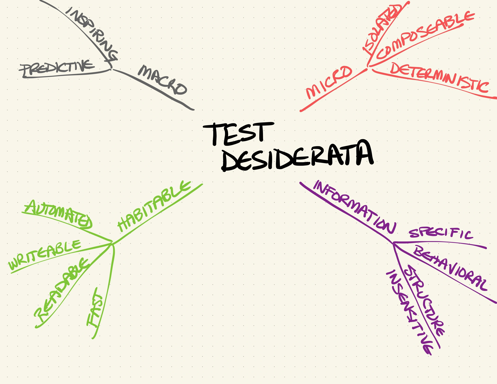
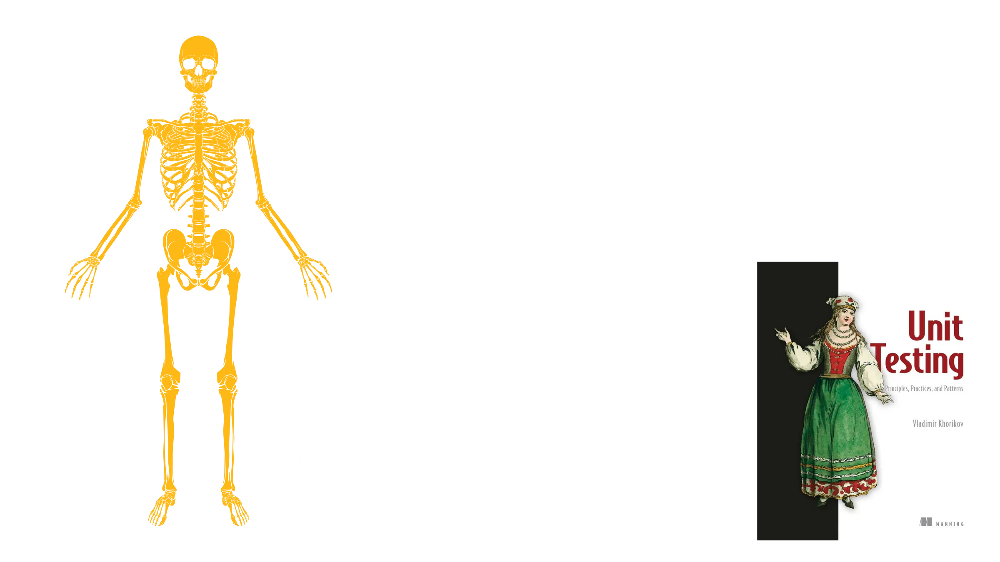

# Les fondamentaux <mark>du test</mark>

30 minutes pour repartir sur des bases communes avant d'explorer les nuances.

---

<span class="kicker">Connexion · en groupe · 10'</span>

# Carte mentale : les tests

Au centre du tableau : **« Un test »**. Construisons ensemble tout ce qu'on y associe.

<div class="cols">
<div>

1. **Seul (3')** : un post-it par idée, le plus possible
2. **En groupe (5')** : on colle, on regroupe, on nomme les branches
3. **Mise en commun (2')** : la branche la plus fournie, la plus vide

</div>
<div>

### Pistes de branches

- **Pourquoi** tester ?
- **Anatomie** : de quoi est fait un test ?
- **Qualités** d'un bon test
- **Types** de tests, outils, frameworks
- **Pièges** et mauvaises odeurs

</div>
</div>

> Gardez la carte affichée : on la complètera au fil du cours.

---

<span class="kicker">Connexion · debrief</span>

# Une carte possible : Test Desiderata

<div class="cols cols--wide-right">
<div>

Kent Beck liste **12 propriétés** souhaitables d'un test, regroupées en 4 familles :

- **Micro** : isolé, composable, déterministe
- **Macro** : prédictif, inspirant
- **Habitable** : automatisé, lisible, facile à écrire, rapide
- **Information** : spécifique, comportemental, insensible à la structure

Ces propriétés **entrent en tension** : on arbitre, test par test.

</div>
<div>



</div>
</div>

<p class="source"><a href="https://testdesiderata.com/" target="_blank">testdesiderata.com</a></p>

---
layout: statement
---

# Avant d'aller plus loin

Et si on faisait l'**anatomie d'un test** ?<br>Qu'est-ce que vous associez à cela ?

---
layout: statement
---



---

<span class="kicker">Concepts</span>

# Anatomie d'un test

```java {all|1|5-6|7-10|12-13|15-18}
class AddANewComment {
    private static final String AUTHOR = "Les Inconnus";
    private static final String A_COMMENT = "C'est exactement ça !!!";

    @Test
    void in_an_article_include_author_and_text() {
        // Arrange
        var article = new Article(
                "Chasse = Un Art ?",
                "C'est sûr que la chasse c'est un art, pour d'autres ça peut être la peinture, la musique...");

        // Act
        var updatedArticle = article.addComment(AUTHOR, A_COMMENT);

        // Assert
        assertThat(updatedArticle.comments())
                .singleElement()
                .isEqualTo(new Comment(AUTHOR, A_COMMENT));
    }
}
```

<!--
Cliquer étape par étape :
1. La classe : un container cohésif, nommé d'après le comportement testé
2. Le nom du test : se lit comme une phrase avec le nom de la classe
3. Arrange : mettre le SUT et ses dépendances dans un état donné
4. Act : une seule ligne, l'appel du comportement
5. Assert : vérifier la sortie, l'état final ou les interactions
-->

---

<span class="kicker">Concepts</span>

# Le pattern AAA (ou Given / When / Then)

<div class="cols">
<div>

| AAA         | BDD       | Rôle                                         |
|-------------|-----------|----------------------------------------------|
| **Arrange** | **Given** | Mettre le SUT et ses dépendances en état     |
| **Act**     | **When**  | Déclencher **le** comportement testé         |
| **Assert**  | **Then**  | Vérifier la sortie, l'état ou l'interaction  |

Une structure uniforme : chaque test se lit **de la même façon**, en quelques secondes.

</div>
<div v-click>

### Les règles du jeu

- **Une seule section de chaque** : plusieurs `Act` ? Ce sont plusieurs tests
- **Act = une ligne** : sinon l'API du SUT expose sans doute un défaut d'encapsulation
- **Pas de `if`** dans un test : un test ne fait pas de choix
- **Arrange le plus grand ?** Normal, mais à factoriser (Builder, Object Mother)
- Nommer clairement le **SUT** pour le distinguer de ses dépendances

</div>
</div>

---

<span class="kicker">Concepts</span>

# Nommer ses tests

Pas de politique stricte : **décrire le scénario comme à un non-dév**, avec le vocabulaire du métier.

```csharp
// ❌ [Méthode]_[Scénario]_[RésultatAttendu] : couplé à l'implémentation
public void IsDeliveryValid_InvalidDate_ReturnsFalse()

// 🤔 Mieux, mais encore bavard
public void Delivery_with_invalid_date_should_be_considered_invalid()

// ✅ Un fait, lisible par le métier
public void Delivery_with_a_past_date_is_invalid()
```

- La classe + la méthode **se lisent comme une phrase** : `AddANewComment.in_an_article_include_author_and_text`
- On teste un **comportement**, pas une méthode : renommer la méthode ne doit pas forcer à renommer le test

<p class="source">Vladimir Khorikov, <em>Unit Testing: Principles, Practices, and Patterns</em></p>

---

<span class="kicker">Concepts</span>

# Les 4 piliers d'un bon test unitaire

<div class="pillars">
<svg class="pillars__temple" viewBox="0 0 360 400" role="img" aria-label="Un temple : le toit Bons tests unitaires repose sur trois colonnes, Protection, Résistance et Feedback rapide, posées sur le socle Maintenabilité">
<polygon class="pl-roof" points="15,128 180,22 345,128"/>
<text class="pl-roof-label" x="180" y="82">Bons tests</text>
<text class="pl-roof-label" x="180" y="108">unitaires</text>
<rect class="pl-beam" x="5" y="128" width="350" height="22"/>
<rect class="pl-col" x="51" y="150" width="48" height="180"/><text class="pl-col-label" transform="translate(75 240) rotate(90)">Protection</text><rect class="pl-col" x="156" y="150" width="48" height="180"/><text class="pl-col-label" transform="translate(180 240) rotate(90)">Résistance</text><rect class="pl-col" x="261" y="150" width="48" height="180"/><text class="pl-col-label" transform="translate(285 240) rotate(90)">Feedback rapide</text>
<rect class="pl-step" x="15" y="330" width="330" height="14"/>
<rect class="pl-base" x="0" y="344" width="360" height="50"/>
<text class="pl-base-label" x="180" y="369">Maintenabilité</text>
</svg>
<div class="pillars__list">
<div v-click class="pillar">
<h3>Protection contre les régressions</h3>
<p>Une régression, c'est un bug. Plus la base de code grossit, plus l'exposition augmente : les tests doivent révéler ces régressions.</p>
</div>
<div v-click class="pillar">
<h3>Résistance au refactoring</h3>
<p>La capacité d'un test à supporter un refactoring du code de production <strong>sans échouer</strong> : pas de faux positifs.</p>
</div>
<div v-click class="pillar">
<h3>Feedback rapide</h3>
<p>Lancer les tests doit raccourcir la boucle de feedback, pas l'allonger.</p>
</div>
<div v-click class="pillar pillar--base">
<h3>Maintenabilité : le socle</h3>
<p>À quel point est-ce difficile de <strong>comprendre</strong> un test ? De le <strong>lancer</strong> ?</p>
</div>
</div>
</div>

<p class="source">Vladimir Khorikov, <em>Unit Testing: Principles, Practices, and Patterns</em></p>

<style>
.pillars { display: grid; grid-template-columns: 330px 1fr; gap: 48px; align-items: center; }
.pillars__temple { width: 100%; height: auto; font-family: var(--font); }
.pillars__temple text { fill: var(--fg); font-weight: 700; text-anchor: middle; dominant-baseline: central; }
.pl-roof, .pl-beam, .pl-col, .pl-step { fill: var(--bg); stroke: var(--line); stroke-width: 3; }
.pl-roof-label { font-size: 22px; }
.pl-col-label { font-size: 19px; }
.pl-base { fill: var(--hl); stroke: var(--line); stroke-width: 3; }
.pillars__temple .pl-base-label { font-size: 22px; fill: var(--onhl); }
.pillars__list { display: grid; gap: 12px; }
.pillar { border-left: 6px solid var(--line); padding: 2px 0 2px 16px; }
.pillar h3 { margin: 0; }
.pillar p { margin: 2px 0 0; font-size: 17px; max-width: none; }
.pillar--base { border-left-color: var(--hl); background: var(--hl); color: var(--onhl); padding: 8px 16px; }
</style>

<!--
Les 4 piliers de Khorikov.
- Protection : le test détecte-t-il une régression ?
- Résistance au refactoring : le test casse-t-il quand on change la structure sans changer le comportement ? (faux positif)
- Feedback rapide : combien de temps pour savoir ?
- Maintenabilité : difficile à comprendre ? difficile à lancer ?
On ne peut pas maximiser les trois premiers en même temps : la résistance au refactoring n'est pas négociable.
-->

---

<span class="kicker">Concepts</span>

# Les tests, notre filet de sécurité

Sans effort, un code ne fait que se dégrader : c'est l'**entropie**.

Pour la combattre, il faut **refactorer** en permanence... et pour refactorer sereinement, il faut un filet de sécurité qui nous prévient dès qu'on casse un comportement : **les tests**.

> Un filet troué donne une fausse impression de sécurité : c'est pire que pas de filet du tout.

<!--
Le refactoring, c'est changer la structure du code sans changer son comportement.
Les tests sont là pour garantir que le comportement reste le même : ils nous donnent le courage de modifier le code.
-->

---

<span class="kicker">Pratique concrète · en binôme</span>

# Autopsie d'un test <span class="timer">7'</span>

<div class="cols cols--wide-left">
<div>

```csharp
[Fact]
public void Test1()
{
    var service = new PartieDeChasseService(new Repo(), () => DateTime.Now);
    var id = service.Demarrer(("Pitibon sur Sauldre", 3),
        new List<(string, int)> { ("Dédé", 20), ("Bernard", 8) });
    service.Tirer(id, "Bernard");
    var partie = new Repo().GetById(id);
    if (partie != null)
    {
        Assert.Equal(7, partie.Chasseurs[1].BallesRestantes);
        service.Tirer(id, "Bernard");
        Assert.Equal(6, partie.Chasseurs[1].BallesRestantes);
    }
}
```

</div>
<div>

1. **Diagnostic (3')** : listez tout ce qui pose problème, en vous appuyant sur l'anatomie et les 4 piliers
2. **Réanimation (4')** : réécrivez-le en AAA, avec un nom qui raconte le scénario

</div>
</div>

<!--
Pistes attendues :
- Nom "Test1" : n'explique rien
- Pas de séparation Arrange / Act / Assert
- Deux Act et deux Assert : deux tests
- Un if : le test peut passer sans rien vérifier (new Repo() vide → partie null → test vert !)
- DateTime.Now : non déterministe
- Chasseurs[1] : couplé à l'ordre, magic number
-->

---

<span class="kicker">Conclusions</span>

# Ce qu'on retient

<svg class="mindmap" viewBox="0 0 1300 500" role="img" aria-label="Carte mentale Un test : pourquoi, anatomie, pièges, qualités, types et outils">
<path class="mm-link mm-link--main" d="M575.0 250 C535.0 250 570.0 85 530.0 85"/>
<path class="mm-link" d="M380.0 85 C330.0 85 355 44.5 308 44.5"/>
<path class="mm-link" d="M380.0 85 C330.0 85 355 71.5 308 71.5"/>
<path class="mm-link" d="M380.0 85 C330.0 85 355 98.5 308 98.5"/>
<path class="mm-link" d="M380.0 85 C330.0 85 355 125.5 308 125.5"/>
<path class="mm-link mm-link--main" d="M575.0 250 C535.0 250 570.0 250 530.0 250"/>
<path class="mm-link" d="M380.0 250 C330.0 250 355 209.5 308 209.5"/>
<path class="mm-link" d="M380.0 250 C330.0 250 355 236.5 308 236.5"/>
<path class="mm-link" d="M380.0 250 C330.0 250 355 263.5 308 263.5"/>
<path class="mm-link" d="M380.0 250 C330.0 250 355 290.5 308 290.5"/>
<path class="mm-link mm-link--main" d="M575.0 250 C535.0 250 570.0 412 530.0 412"/>
<path class="mm-link" d="M380.0 412 C330.0 412 355 358.0 308 358.0"/>
<path class="mm-link" d="M380.0 412 C330.0 412 355 385.0 308 385.0"/>
<path class="mm-link" d="M380.0 412 C330.0 412 355 412.0 308 412.0"/>
<path class="mm-link" d="M380.0 412 C330.0 412 355 439.0 308 439.0"/>
<path class="mm-link" d="M380.0 412 C330.0 412 355 466.0 308 466.0"/>
<path class="mm-link mm-link--main" d="M725.0 250 C765.0 250 730.0 130 770.0 130"/>
<path class="mm-link" d="M920.0 130 C970.0 130 945 89.5 992 89.5"/>
<path class="mm-link" d="M920.0 130 C970.0 130 945 116.5 992 116.5"/>
<path class="mm-link" d="M920.0 130 C970.0 130 945 143.5 992 143.5"/>
<path class="mm-link" d="M920.0 130 C970.0 130 945 170.5 992 170.5"/>
<path class="mm-link mm-link--main" d="M725.0 250 C765.0 250 730.0 372 770.0 372"/>
<path class="mm-link" d="M920.0 372 C970.0 372 945 345.0 992 345.0"/>
<path class="mm-link" d="M920.0 372 C970.0 372 945 372.0 992 372.0"/>
<path class="mm-link" d="M920.0 372 C970.0 372 945 399.0 992 399.0"/>
<rect class="mm-branch" x="380.0" y="65.0" width="150" height="40"/><text class="mm-branch-label" x="455" y="85">Pourquoi ?</text>
<rect class="mm-branch" x="380.0" y="230.0" width="150" height="40"/><text class="mm-branch-label" x="455" y="250">Anatomie</text>
<rect class="mm-branch" x="380.0" y="392.0" width="150" height="40"/><text class="mm-branch-label" x="455" y="412">Pièges</text>
<rect class="mm-branch" x="770.0" y="110.0" width="150" height="40"/><text class="mm-branch-label" x="845" y="130">Qualités</text>
<rect class="mm-branch" x="770.0" y="352.0" width="150" height="40"/><text class="mm-branch-label" x="845" y="372">Types et outils</text>
<rect class="mm-root" x="575.0" y="222.0" width="150" height="56"/><text class="mm-root-label" x="650" y="250">Un test</text>
<text class="mm-leaf" x="300" y="44.5" text-anchor="end">Filet de sécurité</text>
<text class="mm-leaf" x="300" y="71.5" text-anchor="end">Refactorer sans peur</text>
<text class="mm-leaf" x="300" y="98.5" text-anchor="end">Documentation vivante</text>
<text class="mm-leaf" x="300" y="125.5" text-anchor="end">Guider le design</text>
<text class="mm-leaf" x="300" y="209.5" text-anchor="end">Nom = scénario métier</text>
<text class="mm-leaf" x="300" y="236.5" text-anchor="end">Arrange / Given</text>
<text class="mm-leaf" x="300" y="263.5" text-anchor="end">Act / When</text>
<text class="mm-leaf" x="300" y="290.5" text-anchor="end">Assert / Then</text>
<text class="mm-leaf" x="300" y="358.0" text-anchor="end">Plusieurs Act</text>
<text class="mm-leaf" x="300" y="385.0" text-anchor="end">if et boucles</text>
<text class="mm-leaf" x="300" y="412.0" text-anchor="end">Non déterministe</text>
<text class="mm-leaf" x="300" y="439.0" text-anchor="end">Couplé à l'implémentation</text>
<text class="mm-leaf" x="300" y="466.0" text-anchor="end">Test qui ne peut pas échouer</text>
<text class="mm-leaf" x="1000" y="89.5">Protection contre les régressions</text>
<text class="mm-leaf" x="1000" y="116.5">Résistance au refactoring</text>
<text class="mm-leaf" x="1000" y="143.5">Feedback rapide</text>
<text class="mm-leaf" x="1000" y="170.5">Maintenabilité</text>
<text class="mm-leaf" x="1000" y="345.0">Unitaire, intégration, acceptation</text>
<text class="mm-leaf" x="1000" y="372.0">Property-based, mutation</text>
<text class="mm-leaf" x="1000" y="399.0">JUnit, AssertJ</text>
</svg>

<style>
.mindmap { width: 100%; height: auto; max-height: 420px; display: block; margin: 0 auto; font-family: var(--font); }
.mindmap text { dominant-baseline: central; fill: var(--fg); }
.mm-link { fill: none; stroke: var(--line); stroke-width: 1.5; }
.mm-link--main { stroke-width: 4; }
.mm-branch { fill: var(--bg); stroke: var(--line); stroke-width: 3; }
.mm-branch-label { font-size: 17px; font-weight: 700; text-anchor: middle; }
.mm-root { fill: var(--hl); stroke: var(--line); stroke-width: 3; }
.mindmap .mm-root-label { font-size: 24px; font-weight: 700; text-anchor: middle; fill: var(--onhl); }
.mm-leaf { font-size: 16px; }
</style>

<p class="source">Pour aller plus loin : <a href="https://www.manning.com/books/unit-testing" target="_blank">Unit Testing: Principles, Practices, and Patterns</a> (Vladimir Khorikov) · <a href="https://testdesiderata.com/" target="_blank">Test Desiderata</a> (Kent Beck)</p>

<!--
Comparer avec la carte construite par le groupe en connexion : quelles branches manquaient ? Quelles idées du groupe ne sont pas ici ?
- Un test a une anatomie : un nom qui raconte un scénario métier, puis Arrange / Act / Assert
- Un seul Act, pas de logique conditionnelle : un test ne fait pas de choix
- Un bon test tient sur 4 piliers : protection, résistance au refactoring, feedback rapide, maintenabilité
- Les tests sont le filet de sécurité qui rend le refactoring possible... à condition qu'il ne soit pas troué
-->
