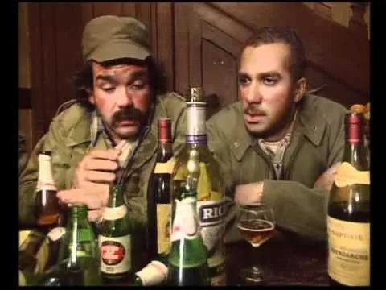
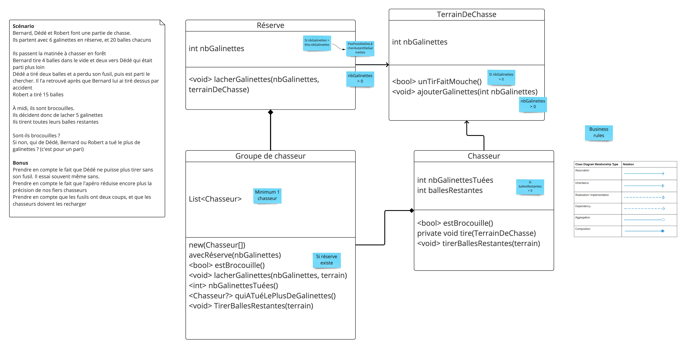

# Une partie de chasse du Bouchonnois



En binôme, implémentez le scénario et les classes ci-dessous **en générant le code depuis son usage**.

## Le scénario

> Bernard, Dédé et Robert font une partie de chasse.
> Ils partent avec **6 galinettes en réserve**, et **20 balles chacun**.
>
> Ils passent la matinée à chasser en forêt :
> - Bernard tire 4 balles dans le vide et 2 vers Dédé, qui était parti plus loin.
> - Dédé tire 2 balles et perd son fusil, puis part le chercher. Il le retrouve après que Bernard lui a tiré dessus par accident.
> - Robert tire 15 balles.
>
> À midi, ils sont **brocouilles**.
> Ils décident donc de **lâcher 5 galinettes**, puis tirent **toutes leurs balles restantes**.
>
> Sont-ils brocouilles ?
> Si non, qui de Dédé, Bernard ou Robert a tué le plus de galinettes ? (c'est pour un pari)

**Bonus**
- Prendre en compte le fait que Dédé ne peut plus tirer sans son fusil (il essaie souvent quand même).
- Prendre en compte le fait que l'apéro réduit encore plus la précision de nos fiers chasseurs.
- Prendre en compte que les fusils ont deux coups, et que les chasseurs doivent les recharger.

## Les User Stories

| #   | User Story                                                                                                                                   | Règles connues                                                                                                                 |
|-----|----------------------------------------------------------------------------------------------------------------------------------------------|--------------------------------------------------------------------------------------------------------------------------------|
| US1 | **En tant que** chasseur du Bouchonnois, **je veux** partir à la chasse avec mes amis **afin de** passer une bonne journée                   | Un groupe contient au minimum 1 chasseur<br>Chaque chasseur part avec ses balles                                               |
| US2 | **En tant que** groupe de chasseurs, **je veux** emporter une réserve de galinettes **afin de** ne pas rentrer bredouille                    | Une réserve contient au moins 1 galinette                                                                                      |
| US3 | **En tant que** groupe de chasseurs, **je veux** lâcher des galinettes de la réserve sur le terrain **afin d'** avoir quelque chose à chasser | Il faut une réserve<br>On lâche au moins 1 galinette<br>On ne peut pas lâcher plus de galinettes que la réserve n'en contient |
| US4 | **En tant que** chasseur, **je veux** tirer sur le terrain **afin de** tuer une galinette                                                    | Il faut au moins 1 balle<br>Un tir ne peut faire mouche que s'il reste des galinettes sur le terrain                          |
| US5 | **En tant que** groupe de chasseurs, **je veux** tirer toutes nos balles restantes **afin de** maximiser nos chances avant de rentrer        | Chaque chasseur tire jusqu'à ne plus avoir de balle                                                                            |
| US6 | **En tant que** chasseur, **je veux** savoir si le groupe est brocouille **afin de** savoir si on rentre la tête haute                       | Brocouille = aucune galinette tuée                                                                                             |
| US7 | **En tant que** parieur, **je veux** savoir qui a tué le plus de galinettes **afin de** désigner le gagnant du pari                          | Il n'y a pas de gagnant si tout le monde est brocouille                                                                        |

## Activité 1 - Illustrer les règles par des exemples (25')

> On ne code pas encore. On cherche des **exemples concrets** pour chaque règle, comme en `Example Mapping`.

1. **Seul (5')** : relisez le scénario et les User Stories. Notez les mots qui vous semblent ambigus.
2. **En binôme (15')** : pour chaque règle, écrivez **au moins un exemple qui passe et un exemple qui échoue**, au format `contexte → action → résultat attendu`.

   ```text
   US3 - On ne peut pas lâcher plus de galinettes que la réserve n'en contient
     ✅ Réserve de 6 galinettes → lâcher 5 → il reste 1 galinette en réserve, 5 sur le terrain
     ❌ Réserve de 6 galinettes → lâcher 7 → PasPossibleDeLâcherAutantDeGalinettes
   ```

3. **Questions (rouges)** : notez tout ce que le scénario ne dit pas. Quelques pistes :
   - Combien de galinettes y a-t-il sur le terrain le matin ?
   - Qu'est-ce qui décide qu'un tir "fait mouche" ? Comment tester un comportement aléatoire ?
   - Que se passe-t-il en cas d'égalité pour le pari ?
   - Un tir sur Dédé consomme-t-il une balle ? Est-il "dans le vide" ?
4. **Mise en commun (5')** : chaque binôme partage son exemple préféré et sa question la plus gênante. Mettez à jour le **Ubiquitous Language** (brocouille, galinette, lâcher, faire mouche...).

## Activité 2 - Écrire un premier scénario de test (15')

1. Choisissez **l'exemple le plus simple** de votre liste, celui qui force le moins de code (souvent un cas d'erreur ou un cas trivial).
2. Écrivez-le en **Given / When / Then** :

   ```gherkin
   Étant donné ...
   Quand ...
   Alors ...
   ```

3. Traduisez-le en test unitaire **comme si le code existait déjà**, puis générez classes et méthodes depuis l'usage (`Alt+Enter` / `⌥⏎`).
4. Vérifiez que le test est **rouge pour la bonne raison** (une assertion qui échoue, pas une erreur de compilation), puis passez au vert.

<details>
<summary>Une proposition de premier scénario et de modèle</summary>

```gherkin
Étant donné une réserve de 6 galinettes
Et un terrain de chasse vide
Quand le groupe lâche 7 galinettes sur le terrain
Alors une erreur "PasPossibleDeLâcherAutantDeGalinettes" est levée
Et la réserve contient toujours 6 galinettes
```

```java
@Test
void on_ne_peut_pas_lacher_plus_de_galinettes_que_la_reserve_n_en_contient() {
    var reserve = new Reserve(6);
    var terrain = new TerrainDeChasse(0);

    assertThatThrownBy(() -> reserve.lacherGalinettes(7, terrain))
            .isInstanceOf(PasPossibleDeLacherAutantDeGalinettes.class);
    assertThat(reserve.nbGalinettes()).isEqualTo(6);
}
```



### Le modèle proposé

| Classe                | État                                             | Comportements                                                                                                                                                                                                                             | Règles métier                                                                                                |
|-----------------------|--------------------------------------------------|-------------------------------------------------------------------------------------------------------------------------------------------------------------------------------------------------------------------------------------------|--------------------------------------------------------------------------------------------------------------|
| **GroupeDeChasseurs** | `List<Chasseur>`                                 | `new(Chasseur[])`<br>`avecRéserve(nbGalinettes)`<br>`bool estBrocouille()`<br>`void lacherGalinettes(nbGalinettes, terrain)`<br>`int nbGalinettesTuées()`<br>`Chasseur? quiATuéLePlusDeGalinettes()`<br>`void tirerBallesRestantes(terrain)` | Minimum 1 chasseur<br>On ne lâche des galinettes que si une réserve existe                                   |
| **Réserve**           | `int nbGalinettes`                               | `void lacherGalinettes(nbGalinettes, terrainDeChasse)`                                                                                                                                                                                    | `nbGalinettes > 0`<br>Si `nbGalinettes > this.nbGalinettes` : erreur `PasPossibleDeLâcherAutantDeGalinettes` |
| **TerrainDeChasse**   | `int nbGalinettes`                               | `bool unTirFaitMouche()`<br>`void ajouterGalinettes(nbGalinettes)`                                                                                                                                                                        | Un tir ne peut faire mouche que si `nbGalinettes > 0`<br>On n'ajoute que `nbGalinettes > 0`                  |
| **Chasseur**          | `int nbGalinettesTuées`<br>`int ballesRestantes` | `bool estBrocouille()`<br>`private void tire(terrain)`<br>`void tirerBallesRestantes(terrain)`                                                                                                                                            | On ne tire que si `ballesRestantes > 0`                                                                      |

Relations :
- un `GroupeDeChasseurs` est **composé** de `Chasseur`s et d'une `Réserve` ;
- la `Réserve` lâche ses galinettes sur un `TerrainDeChasse` ;
- un `Chasseur` **dépend** du `TerrainDeChasse` sur lequel il tire.

</details>

Une fois ce premier test vert, déroulez les exemples suivants un par un, jusqu'à pouvoir répondre à la question du scénario : **sont-ils brocouilles, et qui gagne le pari ?**

Notez les raccourcis découverts au fil de la session.
