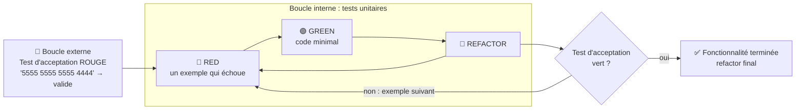
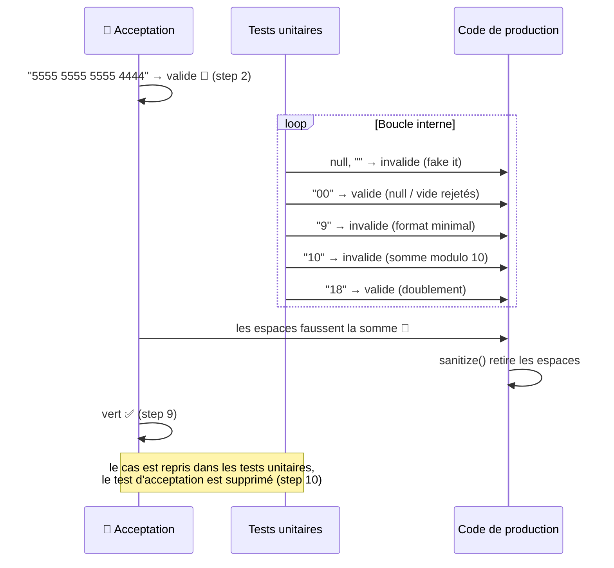

# Kata Luhn : résolution step-by-step en TDD

Ce document retrace la résolution du kata, commit par commit, en suivant le cycle TDD :

| Étape           | Signification                                                   |
|-----------------|-----------------------------------------------------------------|
| 🔴 **RED**      | On écrit un test qui échoue (ou ne compile pas)                 |
| 🟢 **GREEN**    | On écrit le code de prod **minimal** pour le faire passer       |
| 🔵 **REFACTOR** | On améliore le code (test ou prod) sans changer le comportement |

La résolution se fait en **deux temps** :

1. **Partie 1 :** un validateur `Luhn.isValid(String) : boolean`, construit test après test.
2. **Partie 2 :** un parseur `LuhnNumber.parse(String) : Either<LuhnError, LuhnNumber>` (*Parse, don't validate*), qui
   réutilise l'algorithme.

> [Retour à l'énoncé et à l'Example Mapping](README.md)

---

### L'ordre suivi

La liste de tests n'est pas déroulée règle par règle, mais **du cas le plus simple au plus complexe**, chaque exemple forçant une seule évolution du code :

1. `null` → ❌ (*fake it* : `return false`)
2. `"5555 5555 5555 4444"` → ✅ : test d'acceptation qui reste rouge et sert de cap (double boucle)
3. `""` → ❌ (déjà vert : documente la règle)
4. `"00"` → ✅ (premier cas valide)
5. `"9"` → ❌ (format minimal)
6. `"10"` → ❌ (somme naïve modulo 10)
7. `"18"` → ✅ (le doublement émerge)
8. Le test d'acceptation passe au vert (nettoyage des espaces)
9. `"79927398713"`, `"6011 1111 1111 1117"` → ✅ (tests de confiance)
10. Partie 2 : les mêmes exemples, rejoués sur `LuhnNumber.parse` qui retourne un `Either<LuhnError, LuhnNumber>`

### La double boucle

Le test d'acceptation (boucle externe) fixe le **cap** avec un vrai numéro de carte. Il reste rouge pendant que les tests unitaires (boucle interne) font émerger l'algorithme, un petit pas à la fois.



Appliquée au kata, la boucle externe encadre toute la partie 1 :



> Le test d'acceptation évite de se perdre dans les détails : à chaque test unitaire vert, on se demande *"est-ce que ça me rapproche du cap ?"*. Quand il passe au vert, la fonctionnalité est livrée.

---

## Partie 1 : `Luhn.isValid`

### Step 1 : une chaîne `null` est invalide

> Commit `a73803e` : *feat: add first test case*

#### 🔴 RED

On commence par le cas invalide le plus simple. Le test ne compile pas : la classe `Luhn` n'existe pas encore.

```java
@DisplayName("Algo de Luhn")
class LuhnTest {
    @Test
    void fail_for_null() {
        assertThat(Luhn.isValid(null))
                .isFalse();
    }
}
```

#### 🟢 GREEN

Implémentation minimale : on retourne une constante (*fake it*).

```java
public class Luhn {
    public static boolean isValid(String potentialLuhnNumber) {
        return false;
    }
}
```

#### 🔵 REFACTOR

Rien à refactorer pour l'instant.

---

### Step 2 : double boucle TDD, le test d'acceptance

> Commit `214fb69` : *feat: add double loop (integration test)*

#### 🔴 RED

On pose un **test d'intégration** (boucle externe) avec un vrai numéro Mastercard. Il va rester rouge un bon moment : il
sert de **cap** pendant qu'on avance dans la boucle interne avec des tests unitaires plus petits.

```java
public class IntegrationTests {
    @Test
    void succeed_for_master_card() {
        assertThat(
                Luhn.isValid("5555 5555 5555 4444")
        ).isTrue();
    }
}
```

#### 🟢 GREEN

Pas encore : on y reviendra au **Step 9**, quand la boucle interne aura fait émerger l'algorithme.

---

### Step 3 : une chaîne vide est invalide

> Commit `0d4f322` : *feat: add empty test*

#### 🔴 RED

On ajoute le cas de la chaîne vide.

```java
@Test
void fail_for_empty() {
    assertThat(Luhn.isValid(""))
            .isFalse();
}
```

⚠️ Ce test passe **directement** puisque `isValid` retourne toujours `false`. Il ne fait pas avancer le code de prod,
mais documente une règle métier et protègera les prochaines étapes.

#### 🟢 GREEN

Rien à faire, déjà vert.

---

### Step 4 : premier numéro valide, `"00"`

> Commit `65c7aa5` : *feat: minimal implementation test*

#### 🔴 RED

Premier cas **valide** : `"00"` (somme = 0, multiple de 10). Le test échoue car on retourne toujours `false`.

```java
@Test
void succeed_for() {
    assertThat(Luhn.isValid("00"))
            .isTrue();
}
```

#### 🟢 GREEN

On distingue enfin les cas invalides (null / vide) du reste.

```java
public static boolean isValid(String potentialLuhnNumber) {
    return potentialLuhnNumber != null && !potentialLuhnNumber.isEmpty();
}
```

---

### Step 5 : passage aux tests paramétrés

> Commit `f202063` : *refactor use parameterized tests*

#### 🔵 REFACTOR

Les tests `fail_for_null` et `fail_for_empty` ont la même structure : on les fusionne en un **test paramétré** (ajout de
`junit-jupiter-params` dans le `pom.xml`).

```xml
<dependency>
    <groupId>org.junit.jupiter</groupId>
    <artifactId>junit-jupiter-params</artifactId>
    <version>${junit-jupiter-api.version}</version>
    <scope>test</scope>
</dependency>
```

```java
public static Stream<Arguments> invalidTestCases() {
    return Stream.of(
            Arguments.of((Object) null),
            Arguments.of("")
    );
}

@ParameterizedTest
@MethodSource("invalidTestCases")
void fail_for_null(String invalidLuhnNumber) {
    assertThat(Luhn.isValid(invalidLuhnNumber))
            .isFalse();
}
```

Ajouter un cas invalide revient maintenant à ajouter **une ligne**.

---

### Step 6 : un seul chiffre est invalide, `"9"`

> Commit `4ab7ad5` : *feat: add an imp test case*

#### 🔴 RED

`"9"` n'est pas vide donc `isValid` retourne `true` : le test échoue.

```java
public static Stream<Arguments> invalidTestCases() {
    return Stream.of(
            Arguments.of((Object) null),
            Arguments.of(""),
            Arguments.of("9")
    );
}
```

#### 🟢 GREEN

On exige au moins 2 caractères (et on remplace `isEmpty` par `isBlank` pour rejeter les chaînes faites d'espaces).

```java
return potentialLuhnNumber != null
        && !potentialLuhnNumber.isBlank()
        && potentialLuhnNumber.length() > 1;
```

#### 🔵 REFACTOR

On donne un nom à cette règle en extrayant une méthode `hasAValidFormat`.

```java
public class Luhn {
    public static boolean isValid(String potentialLuhnNumber) {
        return hasAValidFormat(potentialLuhnNumber);
    }

    private static boolean hasAValidFormat(String potentialLuhnNumber) {
        return potentialLuhnNumber != null
                && !potentialLuhnNumber.isBlank()
                && potentialLuhnNumber.length() > 1;
    }
}
```

---

### Step 7 : `"10"` est invalide, début de la somme de contrôle

> Commit `16e1423` : *feat: add case 10*

#### 🔴 RED

`"10"` a un format correct, mais sa somme (1 + 0 = 1) n'est pas un multiple de 10. Actuellement on retourne `true` :
rouge.

```java
public static Stream<Arguments> invalidTestCases() {
    return Stream.of(
            Arguments.of((Object) null),
            Arguments.of(""),
            Arguments.of("9"),
            Arguments.of("10")
    );
}
```

#### 🟢 GREEN

Première version (naïve) de la somme de contrôle : on additionne tous les chiffres et on vérifie le modulo 10. Pas
encore de doublement, aucun test ne l'exige.

```java
public static boolean isValid(String potentialLuhnNumber) {
    return hasAValidFormat(potentialLuhnNumber)
            && checkNumber(potentialLuhnNumber);
}

private static boolean checkNumber(String potentialLuhnNumber) {
    int sum = 0;
    // Parcourt chaque caractère de la chaîne, de gauche à droite
    for (char c : potentialLuhnNumber.toCharArray()) {
        // Convertit chaque code de caractère en sa valeur numérique :
        // '0' vaut 48 en Unicode, donc '7' (55) - '0' (48) = 7
        sum += c - '0';
    }
    // Valide si la somme est un multiple de 10
    return sum % 10 == 0;
}
```

#### 🔵 REFACTOR

```java
private static boolean checkNumber(String potentialLuhnNumber) {
    return potentialLuhnNumber.chars()
            .map(c -> c - '0')
            .sum() % 10 == 0;
}
```


---

### Step 8 : `"18"` est valide, le doublement apparaît

> Commit `62e85b4` : *feat: expand algorithm*

#### 🔴 RED

`"18"` : avec la somme naïve on obtient 1 + 8 = 9 donc invalide. Avec Luhn, en partant de la droite, on double le 2ème
chiffre : 8 + (1 × 2) = 10, donc **valide**. Le test échoue.

On en profite pour créer une source de cas valides, sur le même modèle que les cas invalides :

```java
public static Stream<Arguments> validTestCases() {
    return Stream.of(
            Arguments.of("00"),
            Arguments.of("18")
    );
}

@ParameterizedTest
@MethodSource("validTestCases")
void succeed_for(String validLuhnNumber) {
    assertThat(Luhn.isValid(validLuhnNumber))
            .isTrue();
}
```

#### 🟢 GREEN

L'algorithme complet émerge : on inverse la chaîne, on double un chiffre sur deux (indices impairs) et on retire 9 si le
résultat dépasse 9.

```java
private static boolean checkNumber(String potentialLuhnNumber) {
    var digits = new StringBuilder(potentialLuhnNumber).reverse()
            .chars()
            .map(c -> c - '0')
            .toArray();

    return IntStream
            .range(0, digits.length)
            .map(i -> i % 2 == 1 ? doubled(digits[i]) : digits[i])
            .sum() % 10 == 0;
}

private static int doubled(int digit) {
    var result = digit * 2;
    return result > 9 ? result - 9 : result;
}
```

#### 🔵 REFACTOR

- `fail_for_null` est renommé en `fail_for` (il ne teste plus seulement `null`).
- `hasAValidFormat` remonte juste sous `isValid` pour suivre l'ordre de lecture (*step-down rule*).

---

### Step 9 : retour à la boucle externe, le test d'intégration passe au vert

> Commit `b6304dc` : *feat: integration test green*

#### 🔴 RED

Le test d'intégration du **Step 2** est toujours rouge : `"5555 5555 5555 4444"` contient des **espaces**, et
`' ' - '0'` donne une valeur négative qui fausse la somme.

#### 🟢 GREEN

On nettoie la chaîne avant de calculer la somme.

```java
public static boolean isValid(String potentialLuhnNumber) {
    return hasAValidFormat(potentialLuhnNumber)
            && checkNumber(sanitize(potentialLuhnNumber));
}

private static String sanitize(String potentialLuhnNumber) {
    return potentialLuhnNumber.replace(" ", "");
}
```

✅ La double boucle est bouclée : le test d'acceptance est vert.

---

### Step 10 : consolidation des cas valides

> Commit `29edb7e` : *feat: add passing test cases*

#### 🔴 RED

On ajoute les numéros réels de l'énoncé. Ils passent directement : ce sont des tests de **confiance** sur l'algorithme.

```java
public static Stream<Arguments> validTestCases() {
    return Stream.of(
            Arguments.of("00"),
            Arguments.of("18"),
            Arguments.of("5555 5555 5555 4444"),
            Arguments.of("79927398713"),
            Arguments.of("6011 1111 1111 1117")
    );
}
```

#### 🟢 GREEN

Déjà vert.

#### 🔵 REFACTOR

Le cas Mastercard est maintenant couvert par `LuhnTest` : `IntegrationTests` est **supprimé**, il a rempli son rôle de
cap.

---

### Step 11 : validation du format par une regexp

> Commit `5b7f61f` : *refactor: use a regexp*

#### 🔴 RED

Pas de nouveau test.

#### 🟢 GREEN

Pas de nouveau comportement attendu par les tests.

#### 🔵 REFACTOR

Les 3 conditions de format (`isBlank`, `length() > 1`...) sont remplacées par une regexp sur la chaîne nettoyée :
uniquement des chiffres, au moins un.

```java
private static final Pattern regexp = Pattern.compile("^[0-9]+$");

private static boolean hasAValidFormat(String potentialLuhnNumber) {
    return potentialLuhnNumber != null
            && regexp.matcher(sanitize(potentialLuhnNumber)).find();
}
```

ℹ️ Le cas `"9"` reste invalide, mais c'est désormais la **somme de contrôle** qui le rejette (9 n'est pas multiple de
10), plus le format. Bonus : les caractères non numériques (`"Invalid Number"`) sont maintenant rejetés.

---

### Step 12 : découpage en petites fonctions pures

> Commit `382ae8d` : *refactor: split functions*

#### 🔵 REFACTOR

`checkNumber` se lit maintenant comme la description de l'algorithme : **convertir en chiffres → sommer → vérifier le
multiple de 10**.

```java
private static boolean checkNumber(String potentialLuhnNumber) {
    return isMultipleOf10(
            sumDigits(
                    toDigits(potentialLuhnNumber)
            ));
}

private static int sumDigits(int[] digits) {
    return IntStream
            .range(0, digits.length)
            .map(i -> i % 2 == 1 ? doubled(digits[i]) : digits[i])
            .sum();
}

private static int[] toDigits(String potentialLuhnNumber) {
    return new StringBuilder(potentialLuhnNumber).reverse()
            .chars()
            .map(c -> c - '0')
            .toArray();
}

private static int doubled(int digit) {
    var result = digit * 2;
    return result > 9 ? result - 9 : result;
}

private static boolean isMultipleOf10(int sum) {
    return sum % 10 == 0;
}
```

---

## Partie 2 : *Parse, don't validate* avec une monade `Either`

Un `boolean` ne dit pas **pourquoi** ça échoue, et ne garantit rien sur la donnée ensuite. On veut un type qui, une fois
construit, est **forcément** un numéro de Luhn valide : `Either<LuhnError, LuhnNumber>` (via [Vavr](https://vavr.io)).

### Step 13 : `null` donne une erreur explicite

> Commit `50b6a89` : *feat: add first monad impl*

#### 🔴 RED

On ajoute `vavr` et `assertj-vavr` dans le `pom.xml`, puis on repart du cas le plus simple. Le test ne compile pas :
`LuhnParser`, `LuhnError` et `LuhnNumber` n'existent pas.

```xml
<dependency>
    <groupId>io.vavr</groupId>
    <artifactId>vavr</artifactId>
    <version>1.0.1</version>
</dependency>
<dependency>
    <groupId>org.assertj</groupId>
    <artifactId>assertj-vavr</artifactId>
    <version>0.5.1</version>
    <scope>test</scope>
</dependency>
```

```java
@DisplayName("Algo de Luhn")
class LuhnParserTest {
    public static Stream<Arguments> invalidTestCases() {
        return Stream.of(
                Arguments.of((Object) null)
        );
    }

    @ParameterizedTest
    @MethodSource("invalidTestCases")
    void fail_for(String invalidLuhnNumber) {
        assertThat(LuhnParser.parse(invalidLuhnNumber))
                .containsOnLeft(new LuhnError("Invalid Luhn Number"));
    }
}
```

#### 🟢 GREEN

*Fake it* : on retourne toujours une erreur.

```java
public record LuhnError(String reason) {
}

public class LuhnNumber {
}

public class LuhnParser {
    public static Either<LuhnError, LuhnNumber> parse(String potentialLuhnNumber) {
        return Either.left(
                new LuhnError("Invalid Luhn Number")
        );
    }
}
```

#### 🔵 REFACTOR

Voir le step suivant.

---

### Step 14 : un package dédié

> Commit `cdc4411` : *refactor: create package*

#### 🔴 RED

Pas de nouveau test.

#### 🟢 GREEN

Pas de changement de comportement.

#### 🔵 REFACTOR

`LuhnError`, `LuhnNumber` et `LuhnParser` sont déplacés dans `luhn.parse.dont.validate`, pour bien séparer cette
approche de la version `boolean`.

```java
package luhn.parse.dont.validate;

public record LuhnError(String reason) {
}
```

---

### Step 15 : tous les cas, et le parseur devient le constructeur de `LuhnNumber`

> Commit `efcc6bd` : *feat: finish monad impl*

#### 🔴 RED

On rapatrie tous les cas de la partie 1. Les cas invalides passent (on retourne toujours `left`), mais les **cas valides
échouent** : on attend un `right` contenant le numéro.

```java
public static Stream<Arguments> invalidTestCases() {
    return Stream.of(
            Arguments.of((Object) null),
            Arguments.of(""),
            Arguments.of("9"),
            Arguments.of("10")
    );
}

public static Stream<Arguments> validTestCases() {
    return Stream.of(
            Arguments.of("00"),
            Arguments.of("18"),
            Arguments.of("5555 5555 5555 4444"),
            Arguments.of("79927398713"),
            Arguments.of("6011 1111 1111 1117")
    );
}

@ParameterizedTest
@MethodSource("invalidTestCases")
void fail_for(String invalidLuhnNumber) {
    VavrAssertions.assertThat(LuhnNumber.parse(invalidLuhnNumber))
            .containsOnLeft(new LuhnError("Invalid Luhn Number"));
}

@ParameterizedTest
@MethodSource("validTestCases")
void succeed_for(String validLuhnNumber) {
    VavrAssertions.assertThat(LuhnNumber.parse(validLuhnNumber))
            .hasRightValueSatisfying(
                    luhnNumber ->
                            assertThat(luhnNumber.value())
                                    .isEqualTo(validLuhnNumber)
            );
}
```

#### 🟢 GREEN

L'algorithme de la partie 1 est réutilisé tel quel, et la décision est traduite en `right` / `left`.

```java
public static Either<LuhnError, LuhnNumber> parse(String potentialLuhnNumber) {
    return isAValidNumber(potentialLuhnNumber)
            ? right(new LuhnNumber(potentialLuhnNumber))
            : left(new LuhnError("Invalid Luhn Number"));
}

private static boolean isAValidNumber(String potentialLuhnNumber) {
    return hasAValidFormat(potentialLuhnNumber)
            && checkNumber(sanitize(potentialLuhnNumber));
}
```

#### 🔵 REFACTOR

- `LuhnParser` est **supprimé** : `parse` devient une *factory method* de `LuhnNumber`.
- Le constructeur est **privé** : impossible d'obtenir un `LuhnNumber` sans passer par `parse`, donc un `LuhnNumber` est
  valide par construction.

```java
public class LuhnNumber {
    private static final Pattern regexp = Pattern.compile("^[0-9]+$");
    private final String luhnNumber;

    private LuhnNumber(String luhnNumber) {
        this.luhnNumber = luhnNumber;
    }

    public static Either<LuhnError, LuhnNumber> parse(String potentialLuhnNumber) { ...}

    // hasAValidFormat, checkNumber, sumDigits, toDigits, doubled, isMultipleOf10, sanitize

    public String value() {
        return this.luhnNumber;
    }
}
```