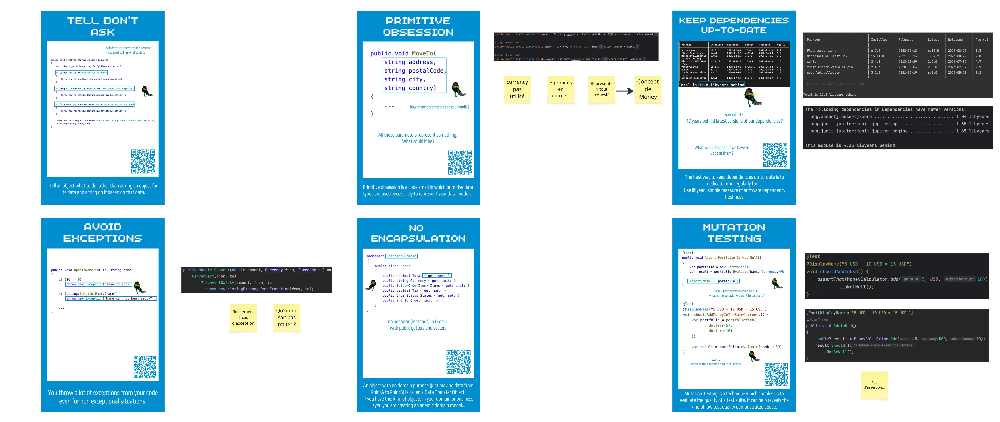

# Before we code
Let's discover the code base by using some cards.

In pair, your mission is to:
- Understand one / two of the cards below
- Find where those rules are violated in the given code base 

  
Débriefe de l'activité

