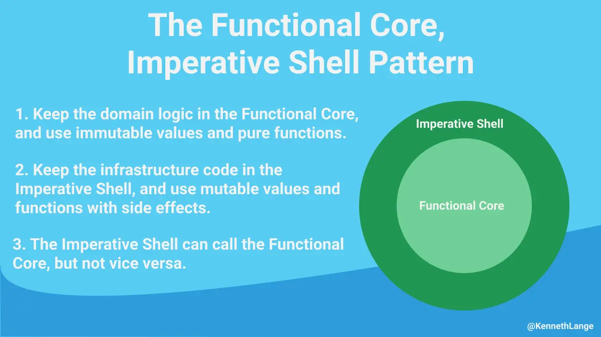

## Functional Core Imperative Shell

Read more about it [here](https://kennethlange.com/functional-core-imperative-shell/)

By using `immutability`, `monads` in our `domain` we have already implemented a `Functional Core`.

Let's go a little further by using a more functional language for our `Functional Core`:
- for `java` let's use `kotlin`
- for `C#` let's use `F#`

We will make our system `polyglot` in terms of programming language.

> What is the impact on the existing code?

### Step-by-step solution
- [java](https://github.com/les-tontons-crafters/xtrem-tdd-money-kata/blob/main/java/docs/12.functional-core-imperative-shell.md)
- [C#](https://github.com/les-tontons-crafters/xtrem-tdd-money-kata/blob/main/c%23/docs/12.functional-core-imperative-shell.md)