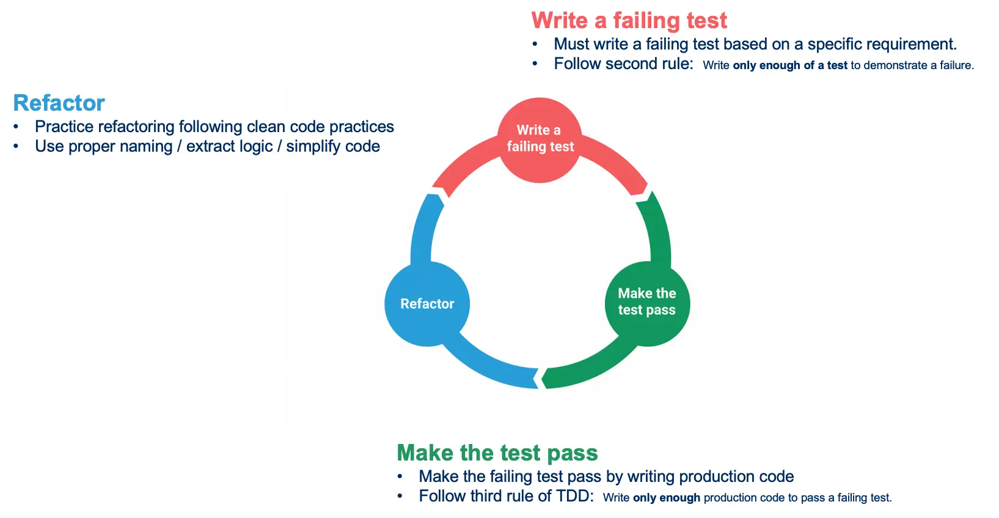
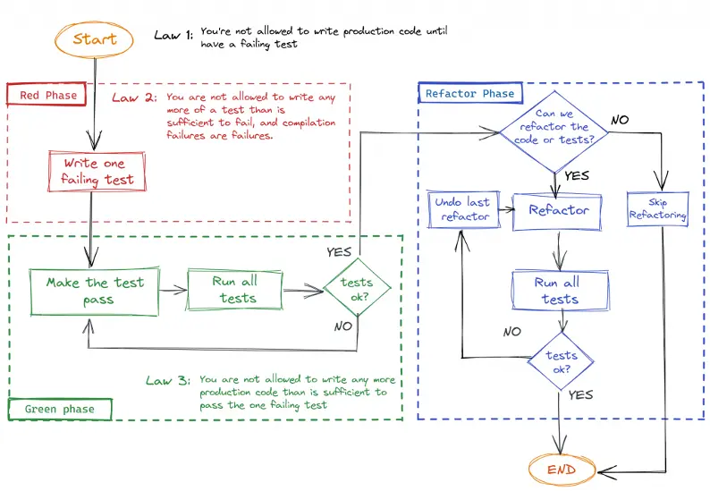
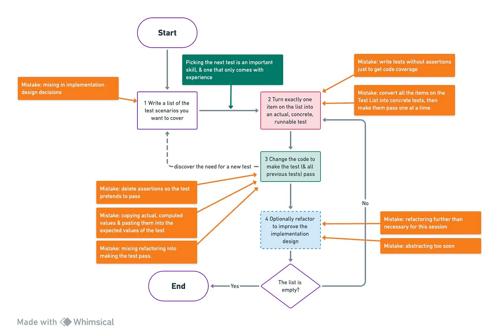
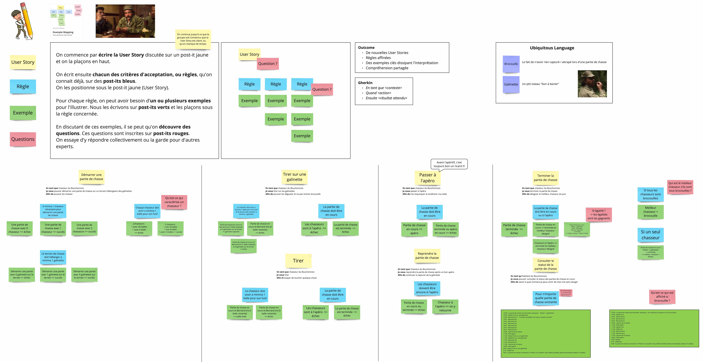
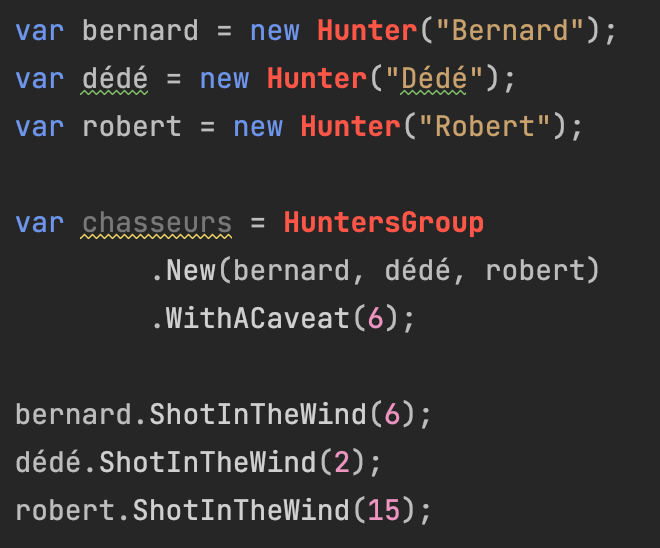
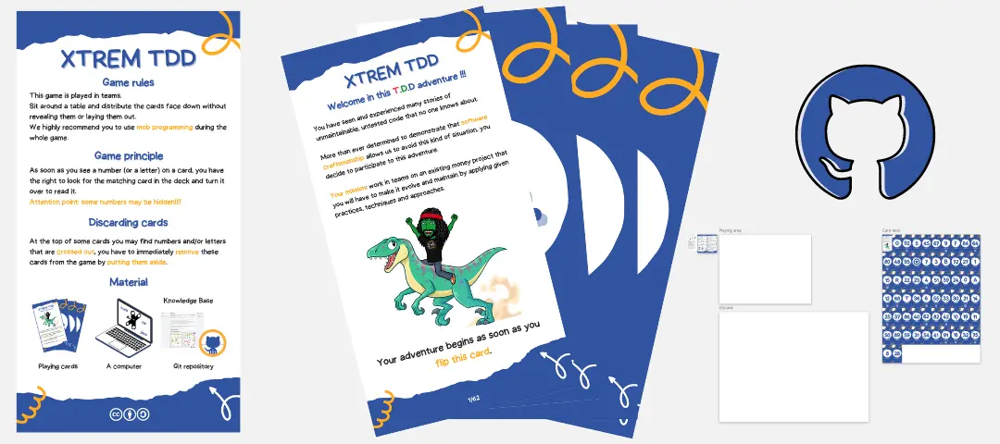

# TDD <mark>Inside-Out</mark>

L'école de Chicago : partir du domaine et laisser les tests faire émerger le design.

---

<span class="kicker">Connexion · en binôme · 2'</span>

# Myth Busters TDD

Pour chaque affirmation : **vraie ou fausse** ? Préparez un argument.

| # | Affirmation                                                              |
|---|--------------------------------------------------------------------------|
| 1 | "TDD c'est écrire des tests *après* le code, pour valider que ça marche" |
| 2 | "TDD ralentit le développement : on passe deux fois plus de temps"       |
| 3 | "TDD ne convient qu'aux projets simples ou greenfield"                   |
| 4 | "Si on a 100 % de couverture, on fait du TDD"                            |
| 5 | "TDD améliore la conception du code, pas seulement sa qualité"           |
| 6 | "On ne peut pas faire du TDD sur du code legacy"                         |
| 7 | "TDD c'est écrire *tous* les tests avant de coder l'implémentation"      |

> Mise en commun : chaque binôme défend sa position, puis on démystifie ensemble.

---
class: dense
---

<span class="kicker">Myth Busters · correction</span>

# Démystifions

| #   | Verdict  | Explication                                                                                                                                                |
|-----|----------|------------------------------------------------------------------------------------------------------------------------------------------------------------|
| 1   | ❌ Faux  | C'est l'inverse : le test est écrit **avant** le code. Il ne valide pas a posteriori, il **guide la conception**.                                           |
| 2   | ❌ Faux  | Des études (Microsoft, IBM) montrent 40 à 90 % de bugs en moins, ce qui compense largement le surcoût initial.                                               |
| 3   | ❌ Faux  | Sur les projets complexes ou long terme, c'est là qu'il apporte le plus : le filet de tests permet de refactorer sans crainte.                              |
| 4   | ❌ Faux  | La couverture mesure les lignes exécutées, pas l'intention. TDD est une **pratique de développement**, pas une métrique.                                    |
| 5   | ✅ Vrai  | Écrire le test en premier force à penser l'API avant l'implémentation : code plus simple, plus découplé, plus testable.                                     |
| 6   | ❌ Faux  | Tests de caractérisation, Sprout Method/Class, Golden Master… Le TDD devient un outil de sécurisation progressive.                                         |
| 7   | ❌ Faux  | **Un test à la fois** : Red → Green → Refactor. Confusion fréquente avec d'autres approches test-first.                                                    |

---

<span class="kicker">Concepts</span>

# Qu'est-ce que le Test-Driven Development ?

Une technique née d'un ensemble de convictions sur le code :

- La **simplicité** : l'art de maximiser la quantité de travail *non* effectué
- L'**évidence et la clarté** sont plus vertueuses que l'astuce
- Écrire du code **sans encombrement** est une composante clé du succès

Issue de l'Extreme Programming (XP), développée par `Kent Beck` sur le projet C3.

> "Test-Driven Development is a way of managing fear during programming." - Kent Beck

---

<span class="kicker">Concepts</span>

# Concevoir et structurer le code

<div class="cols">
<div>

Le TDD **ne porte pas sur les tests**. Les tests sont notre **filet de sécurité**, pas l'objectif.

Il s'agit de :
- Améliorer la **conception et la structure** du code
- Pouvoir **refactorer en toute sécurité**

</div>
<div>

### Confiance accrue

- Chaque nouveau test sollicite le système de façons nouvelles
- Au fil du temps, la suite protège contre les régressions
- Un **retour rapide** permanent sur l'état du système (*fast feedback-loop*)

</div>
</div>

---

<span class="kicker">Concepts</span>

# Un biais vers la simplicité

<div class="cols">
<div>

Mesurer la simplicité :
- Moins de lignes de code par fonctionnalité
- Complexité cyclomatique plus basse
- Moins d'effets de bord
- Empreinte mémoire / CPU réduite

TDD force à construire la chose la plus simple qui fonctionne (**YAGNI**).

</div>
<div>

Mais ce n'est pas une baguette magique. Il ne réduit pas nécessairement :
- Le temps de développement
- Le nombre de lignes de code
- Le nombre de défauts

</div>
</div>

---

<span class="kicker">Concepts</span>

# Les briques du TDD

Une approche **scientifique** : écrire une hypothèse, lancer l'expérience, observer, essayer autre chose, recommencer.



---

<span class="kicker">Concepts</span>

# Red, Green, Refactor

| Phase           | Description                                                                                                                     |
|-----------------|---------------------------------------------------------------------------------------------------------------------------------|
| 🔴 **Red**      | Écrire un test qui échoue (les erreurs de compilation comptent). Exécuter la suite pour vérifier l'échec.                       |
| 🟢 **Green**    | Écrire **juste assez** de code pour passer le test. Être le "développeur sale" une minute : hardcoder, dupliquer. Aller vite.  |
| 🔵 **Refactor** | Supprimer les code smells : duplication, valeurs en dur, idiomes mal utilisés. Si un test casse : priorité au retour au vert. |

---

<span class="kicker">Concepts</span>

# Les 3 règles d'Uncle Bob

<div class="cols cols--wide-right">
<div>

1. N'écrire du code de production **que** pour faire passer un test unitaire en échec.
2. N'écrire d'un test unitaire **que** ce qui est suffisant pour échouer (les erreurs de compilation sont des échecs).
3. N'écrire du code de production **que** ce qui est nécessaire pour faire passer le seul test en échec.

</div>
<div>



</div>
</div>

---

<span class="kicker">Concepts</span>

# Baby Steps

**Avancer par incréments minuscules**, en restant le plus souvent possible au vert. Si un test prend plus de quelques minutes à passer, on a mordu trop grand.

| Grosse étape                      | Baby step                                             |
|-----------------------------------|-------------------------------------------------------|
| On est rouge longtemps            | On revient au vert rapidement                         |
| On accumule plusieurs changements | Un seul changement à la fois = cause d'échec évidente |
| Refactoring risqué                | Refactoring sûr sur base stable                       |
| Difficile d'annuler               | `git checkout` ou `Ctrl+Z` suffit                     |

> "Make it work, make it right, make it fast." - Kent Beck

---

<span class="kicker">Concepts</span>

# Baby Steps en pratique

- Commencer par le cas le plus simple possible (souvent le cas trivial ou le cas nul)
- Résister à l'envie de "tout faire en une fois"
- Si le test rouge semble trop complexe à faire passer : le découper en un test encore plus petit
- Hardcoder la valeur en phase Green si nécessaire : la généralisation vient au Refactor ou au test suivant

### Le Pair Programming en TDD

Changer de rôle à chaque **nouveau test en rouge**.

> Le style **Ping-Pong** : l'un écrit le test rouge, l'autre écrit le code vert et refactore, puis les rôles s'inversent.

---

<span class="kicker">Concepts</span>

# Canon TDD : partir des exemples



---

<span class="kicker">Concepts</span>

# Example Mapping

Une technique collaborative pour clarifier les critères d'acceptation d'une Story *avant* de coder.



---

<span class="kicker">Concepts</span>

# Example Mapping : comment ça se déroule

<div class="cols">
<div>

1. **Présenter** : un expert métier introduit la story avec des exemples concrets
2. **Construire** : l'équipe pose des questions, identifie les règles et les cas limites
3. **Formaliser** : les exemples peuvent être écrits en Gherkin (Given / When / Then)

</div>
<div>

### Bonnes pratiques

- Laisser un temps de réflexion individuelle avant la discussion de groupe
- Capturer le **Ubiquitous Language** : quand une ambiguïté de vocabulaire surgit, la définir ensemble
- S'arrêter quand le périmètre est clair, ou quand le temps est écoulé

</div>
</div>

> L'outcome n'est pas un document. C'est une **compréhension partagée**.

---

<span class="kicker">Concepts</span>

# Generate Code From Usage

<div class="cols cols--wide-left">
<div>

Écrire d'abord l'appel (le test), *puis* laisser l'IDE générer la structure.

```text
Contrainte : vous n'avez le droit de créer du code nouveau
qu'à partir de son usage (depuis un test ou du code de production).
```

1. Écrire le test comme si le code existait déjà
2. L'IDE souligne les identifiants manquants en rouge
3. `Alt+Enter` / `⌥⏎` pour générer classe, méthode, propriété, type
4. Passer à l'erreur suivante et recommencer

</div>
<div>



</div>
</div>

---

<span class="kicker">Concepts</span>

# Pourquoi générer depuis l'usage ?

- Elle maintient le **flux de pensée** : on reste dans l'intention, pas dans l'implémentation
- Elle garantit une **API orientée usage** : on conçoit depuis le point de vue de l'appelant
- Elle réduit les erreurs de copier-coller manuels
- Elle est **parfaitement alignée avec TDD** : Red d'abord, génération ensuite

---

<span class="kicker">Pratique concrète · en binôme</span>

# Une partie de chasse du Bouchonnois

<div class="cols cols--wide-left">
<div>

Bernard, Dédé et Robert partent à la chasse avec **6 galinettes en réserve** et **20 balles chacun**. À midi, ils sont **brocouilles** : ils lâchent 5 galinettes et tirent toutes leurs balles restantes.

**Sont-ils brocouilles ? Qui a tué le plus de galinettes ?**

Implémentez-le **en générant le code depuis son usage**.

</div>
<div>


</div>
</div>

<div class="exercise"><span class="exercise__tag">Exercice</span><a href="https://github.com/ythirion/50-nuances-tdd-m1/tree/main/01.tdd-inside-out/exercices/bouchonnois">01.tdd-inside-out/exercices/bouchonnois</a></div>

---

<span class="kicker">Pratique concrète · Bouchonnois</span>

# Activité 1 : illustrer les règles <span class="timer">25'</span>

> On ne code pas encore. On cherche des **exemples concrets** pour chaque règle.

1. **Seul (5')** : relisez le scénario et les User Stories, notez les mots ambigus
2. **En binôme (15')** : pour chaque règle, **un exemple qui passe et un qui échoue**

```text
US3 - On ne peut pas lâcher plus de galinettes que la réserve n'en contient
  ✅ Réserve de 6 galinettes → lâcher 5 → 1 en réserve, 5 sur le terrain
  ❌ Réserve de 6 galinettes → lâcher 7 → PasPossibleDeLâcherAutantDeGalinettes
```

3. **Questions (rouges)** : tout ce que le scénario ne dit pas
4. **Mise en commun (5')** : votre exemple préféré, votre question la plus gênante

---

<span class="kicker">Pratique concrète · Bouchonnois</span>

# Activité 2 : un premier scénario de test <span class="timer">15'</span>

1. Choisissez **l'exemple le plus simple**, celui qui force le moins de code
2. Écrivez-le en **Given / When / Then**

```gherkin
Étant donné ...
Quand ...
Alors ...
```

3. Traduisez-le en test **comme si le code existait déjà**, puis générez depuis l'usage
4. Vérifiez qu'il est **rouge pour la bonne raison**, puis passez au vert

Déroulez ensuite les exemples un par un, jusqu'à répondre : **sont-ils brocouilles, et qui gagne le pari ?**

---

<span class="kicker">Pratique concrète · Xtrem TDD</span>

# Xtrem TDD : le Money Problem

<div class="cols">
<div>

Pratiquer le TDD **en mob programming**, avec des contraintes tirées au hasard :

- Utiliser TCR (Test && Commit \|\| Revert)
- Utiliser un Test Data Builder
- N'écrire que des fonctions pures
- Vérifier ses tests avec du Mutation Testing
- Pas de types primitifs, pas de boucles, pas d'exceptions…

</div>
<div>



</div>
</div>

<div class="exercise"><span class="exercise__tag">Exercice</span><a href="https://github.com/ythirion/50-nuances-tdd-m1/tree/main/01.tdd-inside-out/exercices/xtrem-tdd">01.tdd-inside-out/exercices/xtrem-tdd</a></div>

---

<span class="kicker">Pratique concrète · Kata</span>

# L'algorithme de Luhn

Avant d'interroger la banque, détecter qu'un numéro de carte a été **mal saisi**.

1. En partant de la droite, **doubler un chiffre sur deux** (à partir de l'avant-dernier)
2. Si le double dépasse 9, lui **soustraire 9**
3. **Additionner** tous les chiffres
4. Le numéro est valide si la somme est un **multiple de 10**

Avant de coder : construisez votre **Example Mapping**. Puis laissez les tests faire émerger l'algorithme, avec une **double boucle**.

<div class="exercise"><span class="exercise__tag">Exercice</span><a href="https://github.com/ythirion/50-nuances-tdd-m1/tree/main/01.tdd-inside-out/exercices/luhn">01.tdd-inside-out/exercices/luhn</a></div>

---

<span class="kicker">Concepts</span>

# Utiliser TDD sur du code existant

<div class="cols">
<div>

Le code existant est rarement testable tel quel :
- Dépendances cachées (base, fichiers, horloge...)
- Classes omniscientes, méthodes de 300 lignes
- Couplage fort entre les modules

```text
1. Caractériser → figer le comportement actuel
2. Sécuriser    → rendre le code testable
3. Avancer      → reprendre Red → Green → Refactor
```

</div>
<div>

| Technique                    | Quand l'utiliser                                         |
|------------------------------|----------------------------------------------------------|
| **Tests de caractérisation** | Figer le comportement observé (même buggé)               |
| **Golden Master**            | Sorties volumineuses : comparer avant / après            |
| **Sprout Method / Class**    | Ajouter une fonctionnalité sans toucher à l'existant     |
| **Seam (couture)**           | Injecter un comportement de test sans modifier le code   |

</div>
</div>

> Règle d'or : ne jamais modifier du code non couvert par des tests.

---

<span class="kicker">Conclusions</span>

# Ce qu'on retient

- Le TDD n'est pas une technique de test, c'est une **technique de design**
- Commencer par les **exemples** clarifie le comportement *avant* d'écrire une ligne
- L'**Example Mapping** structure cette réflexion collective
- Écrire d'abord l'usage (test) puis générer le code maintient le flux et oriente l'API
- Un cycle court (rouge → vert → refactor) est un filet de sécurité permanent

---

<span class="kicker">Conclusions</span>

# Le test comme documentation vivante

```typescript
// ❌ Test opaque
it('test fizzBuzz', () => {
  expect(fizzBuzz(15)).toBe('FizzBuzz')
})

// ✅ Test documenté
it('retourne FizzBuzz pour les multiples de 3 et de 5', () => {
  const nombreMultipleDe3Et5 = 15

  const resultat = fizzBuzz(nombreMultipleDe3Et5)

  expect(resultat).toBe('FizzBuzz')
})
```

Un bon test répond à trois questions sans les commenter : **quoi, avec quoi, pourquoi ?**

---

<span class="kicker">Conclusions</span>

# Questions pour la suite

- Qu'est-ce qui change dans votre façon de commencer une feature demain matin ?
- Dans quel contexte de votre quotidien pourriez-vous appliquer l'`Example Mapping` ?
- Quel raccourci IDE allez-vous adopter cette semaine ?

### Ressources

- [Concepts derrière T.D.D](https://github.com/les-tontons-crafters/xtrem-tdd-money-kata/blob/main/docs/concepts.md) · [Canon T.D.D](https://tidyfirst.substack.com/p/canon-tdd)
- [Example Mapping](https://xtrem-tdd.netlify.app/flavours/practices/example-mapping/) · [Generate Code From Usage](https://xtrem-tdd.netlify.app/flavours/design/generate-code-from-usage/)
- [FizzBuzz Kata](https://github.com/ythirion/fizzbuzz-kata) · [Test-Driven Development by Example](https://www.amazon.com/Test-Driven-Development-Kent-Beck/dp/0321146530)
- [Software Craft : TDD, Clean Code et autres pratiques essentielles](https://www.dunod.com/sciences-techniques/software-craft-tdd-clean-code-et-autres-pratiques-essentielles-0)
