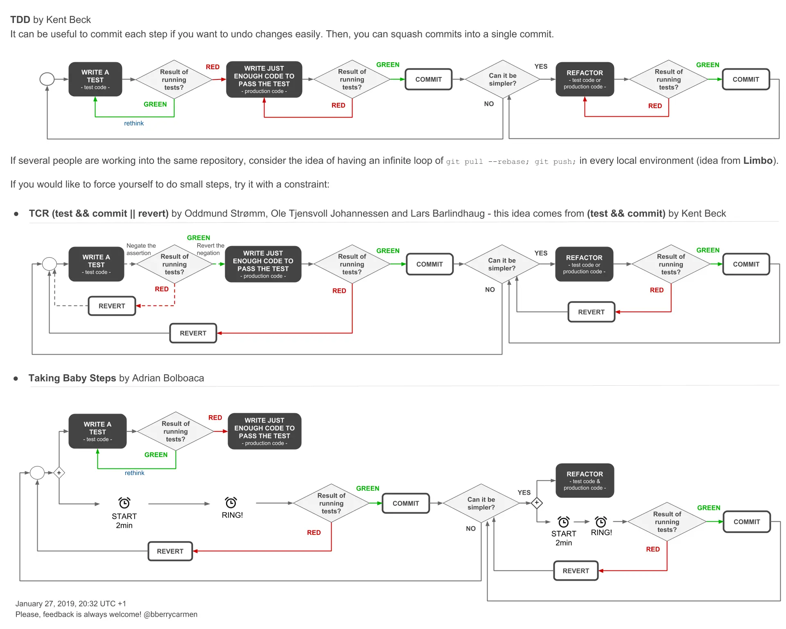
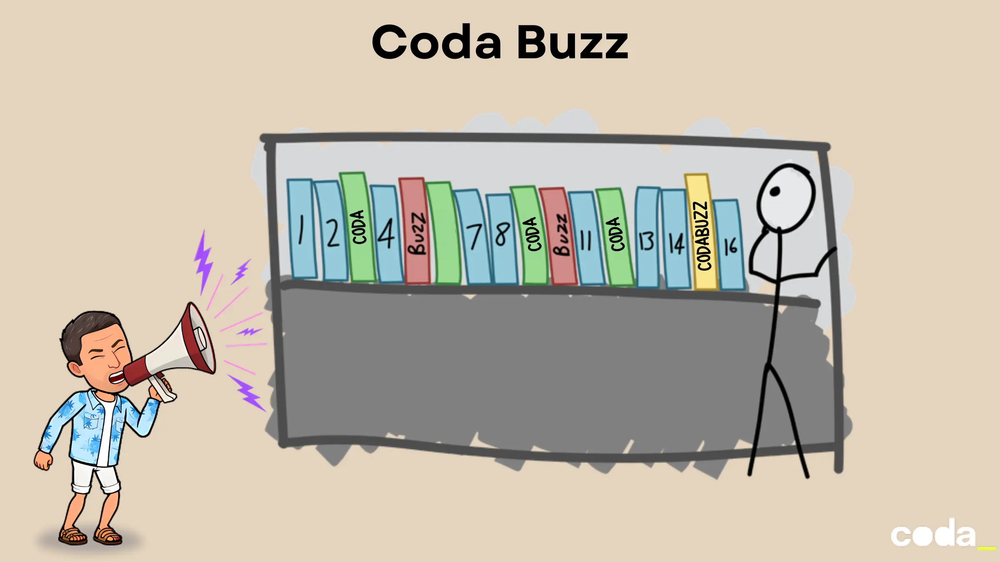

# Test && Commit <mark>|| Revert</mark>

Quand git annule tout ce que tu viens d'écrire, tu apprends vite à faire des petits pas.

---

<span class="kicker">Connexion · réflexion individuelle · 2'</span>

# Et si git effaçait ton code ?

> **Imagine que chaque fois que tes tests échouent, git annule automatiquement tout ce que tu viens d'écrire.**

Note tes premières réactions :
- Qu'est-ce que ça change dans ta façon de coder ?
- Qu'est-ce qui te ferait peur ? Qu'est-ce qui t'attirerait ?

Partage avec ton voisin ou garde ça pour la discussion de groupe.

---

<span class="kicker">Concepts</span>

# Qu'est-ce que TCR ?

<div class="cols">
<div>

Une discipline proposée par Kent Beck, qui tient en une ligne :

```bash
test && git commit -am "." || git revert --no-edit HEAD
```

- Si les tests **passent** → `git commit` automatique
- Si les tests **échouent** → `git revert` automatique

**Ce n'est pas un outil.** C'est une contrainte volontaire, comme coder sans souris ou sans boucles.

</div>
<div>



</div>
</div>

---

<span class="kicker">Concepts</span>

# TCR vs TDD

| Aspect             | TDD classique               | TCR                                       |
|--------------------|-----------------------------|-------------------------------------------|
| Cycle              | Red → Green → Refactor      | Write → Test (auto commit ou auto revert) |
| En cas d'échec     | Tu fixes le test ou le code | Ton code **disparaît**, tu recommences    |
| Commit             | Manuel, quand tu veux       | Automatique à chaque test vert            |
| Granularité forcée | Recommandée, pas imposée    | Imposée par la douleur du revert          |
| Filet de sécurité  | Tests                       | Néant (c'est le principe)                 |

> **Piège courant** : TCR ne veut pas dire "commiter sur chaque ligne". TCR te force à découper ton intention en unités testables. Si tu perds ton code souvent, tu codes trop gros.

---

<span class="kicker">Concepts</span>

# Pourquoi ça force les baby steps

En TDD, personne ne t'oblige à faire de petits pas. En TCR, le revert automatique est douloureux.

Si tu perds régulièrement du travail, c'est que :
1. Tes changements sont trop grands pour être validés d'un coup
2. Tu n'as pas de test pour guider ta prochaine micro-étape
3. Tu essaies de tout faire en même temps

```text
Intention → Micro-changement → Test → Commit (ou revert)
     ↑_______________________________________________|
```

---

<span class="kicker">Pratique concrète · en binôme</span>

# Coda Buzz avec TCR

<div class="cols cols--wide-left">
<div>

Pour un nombre de 1 à 100, retourner ce nombre, sauf :
- Multiples de 3 : `"Coda"`
- Multiples de 5 : `"Buzz"`
- Multiples de 3 **et** de 5 : `"CodaBuzz"`

> Avant de coder, construire un **Example Mapping**.

</div>
<div>



</div>
</div>

<Exercise path="02.tcr/exercices/codabuzz" />

---

<span class="kicker">Pratique concrète · Coda Buzz</span>

# L'outil TCR

À lancer depuis la racine de `exercices/codabuzz` :

```shell
# Java
./tcr/MacOs/tcr -b java/ -w java/ -t maven
./tcr/Linux/tcr -b java/ -w java/ -t maven
.\tcr\Windows\tcr.exe -b .\java\ -w .\java\ -l java -t maven

# C#
./tcr/MacOs/tcr -b csharp/ -w csharp/ -l csharp
./tcr/Linux/tcr -b csharp/ -w csharp/ -l csharp
.\tcr\Windows\tcr.exe -b .\csharp\ -w .\csharp\ -l csharp
```

- **D** : rôle Driver pour les 5 prochaines minutes
- **N** : rôle Navigator, qui récupère les commits en continu
- Respectez la rotation : **un seul driver à la fois**

---

<span class="kicker">Pratique concrète · Coda Buzz</span>

# Trop facile ?

<div class="cols">
<div>

- Supprimez les `if` de votre code
- Paramétrez le code : `limit = 100`, `fizz = 3`, `buzz = 5`
- Étendez votre programme :
  - Les multiples de 7 sont `Whizz`
  - Les multiples de 11 sont `Bang`

</div>
<div>

- Utilisez une `Higher Order Function`
- Ajoutez une sortie vocale
- Écrivez-le dans un langage inconnu (toujours en TDD)
- ...

</div>
</div>

---

<span class="kicker">Conclusions · réfléchis seul, puis en binôme</span>

# TCR et agents IA ?

Les agents IA (Copilot, Claude Code, Cursor…) peuvent générer du code, lancer des tests et commiter de manière autonome.

1. Si un agent IA génère du code à ta place, qui "subit" le revert en cas d'échec, toi ou lui ? Est-ce que ça change quelque chose ?
2. TCR force le développeur humain à faire de petits pas. Un agent IA a-t-il naturellement ce réflexe, ou va-t-il générer de gros blocs d'un coup ?
3. Imagine un pipeline : *agent IA génère → TCR valide ou revert → agent IA rejoue*. Qu'est-ce que ça garantit ? Qu'est-ce que ça ne garantit pas ?

### Ressources

- [Kent Beck : "test && commit || revert"](https://medium.com/@kentbeck_7670/test-commit-revert-870bbd756864) · [TCR Tool](https://github.com/murex/TCR)
- [How Practicing TCR Reduces Batch Size](https://www.infoq.com/articles/test-commit-revert/)
