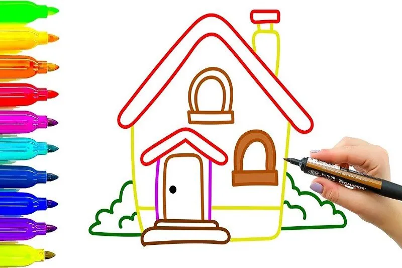
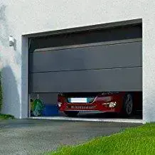
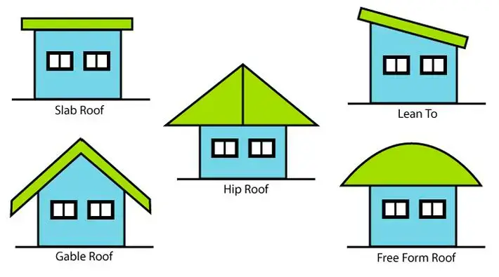

# Deses'po'rate Housewives *(~15 min)*

**Matériel** : crayons de couleur, feuilles A4 (une par groupe).
**Fichier facilitation** : [desporate-housewives.pdf](desporate-housewives.pdf)

## Sprint 1 - *"Dessine une maison"* (5 min)

> **#1 - Construire une maison**
>
> Dessine une maison sur une feuille A4.
>
> *Caractéristiques - la maison doit avoir :*
> - Une porte
> - Un toit
> - Un garage
> - Des fenêtres

- **Production - 2 min** : chaque groupe "construit".
- **Revue - 1 min** : chaque groupe présente son résultat.
- **Inspection & adaptation - 1 min** : comparez les dessins entre groupes. Qu'est-ce qui diffère ? Pourquoi ?

## Sprint 2 - *"Dessine MA maison"* (5 min)

> **#2 - Dessine MA maison**
>
> La maison a deux étages (rez-de-chaussée et premier étage), un garage suffisamment grand pour un véhicule, et toutes les fenêtres sont identiques.
>
> *Caractéristiques :*
> - **Rez-de-chaussée** : la porte d'entrée est verte, une fenêtre est placée à gauche
> - **Premier étage** : deux fenêtres et un toit "hip roof"
> - **Garage** : une porte de garage sectionnelle bleue avec un toit-terrasse

Le client est maintenant disponible si les groupes ont des questions.

- **Production - 2 min**
- **Revue - 1 min**

Ubiquitous Language

- **Portes de garage sectionnelles** : elles sont constituées de panneaux distincts qui s'ouvrent verticalement.

Schéma illustrant différents types de toitures :

## Débriefing *(3 min - uniquement à la fin du jeu)*

Affichez les dessins des deux sprints côte à côte :

| Ce qu'on a vécu                                        | Ce que BDD adresse                                                                         |
|--------------------------------------------------------|--------------------------------------------------------------------------------------------|
| Sprint 1 : chaque équipe a livré une maison différente | Sans critères d'acceptance, chacun implémente *sa* vision                                  |
| Le client absent = interprétations divergentes         | **Disponibilité du PO** : en BDD, les 3 Amigos réunissent les perspectives *avant* le code |
| "Porte de garage sectionnelle" ? "Toit à 4 pentes" ?   | **Langage ubiquitaire** : Gherkin force à nommer les concepts précisément                  |
| Sprint 2 : le résultat convergé sans effort de code    | Des critères d'acceptance précis : des scénarios Given/When/Then                           |
| On peut finir avant la fin du temps                    | Pas de sur-ingénierie : livrer ce qui est demandé, rien de plus                            |

> La carte du Sprint 1 ressemble à un ticket Jira sans acceptance criteria. La carte du Sprint 2 ressemble à un scénario Gherkin. La session 3 Amigos, c'est le moment où l'équipe pose les questions qui transforment la première carte en deuxième.

- [Des'po'rate housewives sur play14](https://play14.org/games/desporate-housewives)
