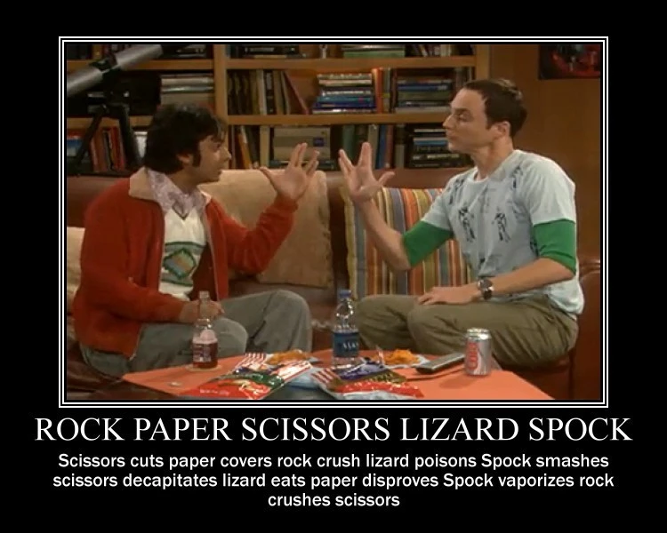
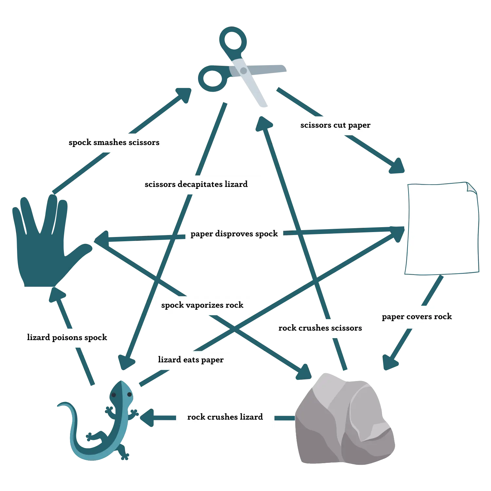

# Rock Paper Scissors Lizard Spock

## Exercice 1 - Example Mapping

**Story** :
> *En tant que joueur, je veux savoir qui a gagné une manche, afin de pouvoir arbitrer une dispute avec un ami.*

**Instructions** :

1. Formez des groupes de 3 : un développeur, un testeur, un "PO" (celui qui connaît le mieux les règles du jeu)
2. Matérialisez les cartes avec du papier ou un tableau (4 couleurs ou 4 symboles)
3. Identifiez les règles métier (🔵) - combien y en a-t-il ?
4. Pour chaque règle, donnez au moins 2 exemples concrets (🟢)
5. Notez toutes les questions ouvertes (🔴) - ne les résolvez pas encore

**Critères de succès** :
- [ ] Au moins 5 règles identifiées (les 10 combinaisons gagnantes)
- [ ] Chaque règle a au moins un exemple concret
- [ ] Au moins une question rouge levée (ex : coup invalide, égalité)
- [ ] Tous les membres du groupe ont contribué.

## Exercice 2 - Implémenter Rock Paper Scissors Lizard Spock

Voici les règles complètes du jeu :

**Objectif** : implémenter le jeu complet en partant de zéro avec BDD. Un scénario Gherkin d'abord, le code ensuite.

**Instructions** :

1. Ouvre le dossier de ton langage (`java/`, `csharp/` ou `ts/`), il contient le squelette
2. Commence par écrire 1 scénario `Gherkin` dans le `feature file`
3. Lance les tests, ils doivent être **rouges** (step definitions non implémentées)
4. Implémente les step definitions : colle entre `Gherkin` et `code de production`
5. Implémente le code de production pour faire passer le scénario (boucle TDD interne)
6. Refactoring si nécessaire

**Critères de succès** :
- [ ] Les scénarios Gherkin sont écrits avant le code de production
- [ ] Les 10 combinaisons gagnantes sont couvertes par des scénarios
- [ ] L'égalité est couverte
- [ ] Les step definitions ne contiennent aucune logique métier
- [ ] Le refactoring a été fait si du code dupliqué est apparu

## Bonus : documentation vivante *(optionnel)*

Les scénarios Gherkin sont à la fois des tests et de la documentation.

1. Génère un rapport HTML de tes scénarios (Cucumber intègre cette feature nativement)
2. Lis-le comme si tu étais le PO : les scénarios se lisent-ils comme une spécification claire ?
3. Modifie les noms de scénarios ou les libellés Given/When/Then pour qu'ils soient compréhensibles sans avoir lu le code

*Un bon scénario BDD est une spécification que le métier peut valider sans connaître le code.*

## Pour aller plus loin

- Le [challenge Advent of Craft](challenge.md) : étendre un programme existant en BDD
- [Le guide de solution](solution/step-by-step.md)
- Le code de solution est disponible [ici](https://github.com/advent-of-craft/2024/tree/main/solution/day18), avec un focus sur le [tableau dans la feature](https://github.com/advent-of-craft/2024/blob/main/solution/day18/features/rockPaperScissorsLizardSpock.feature)
