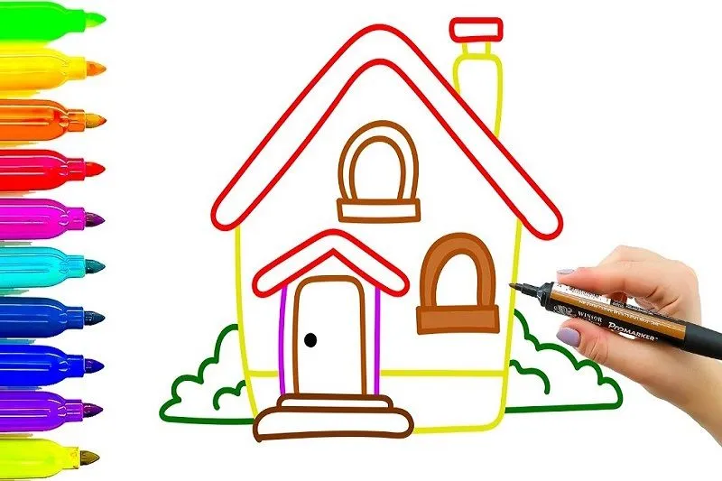
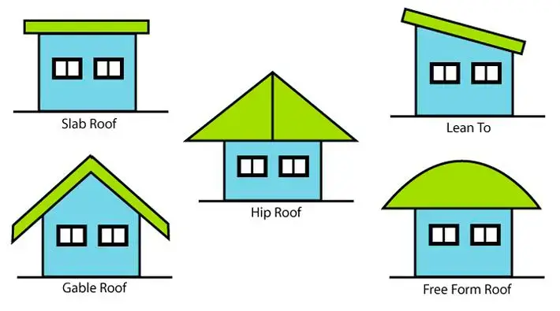
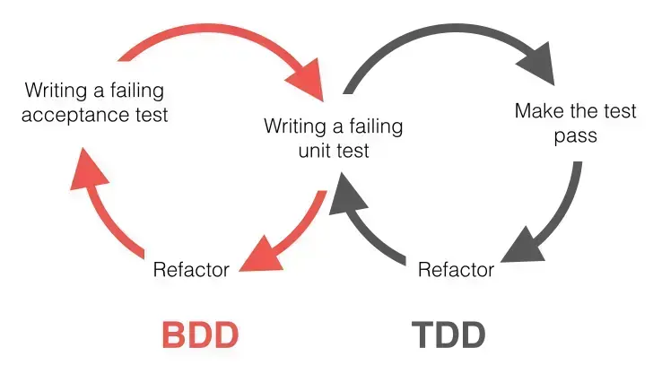
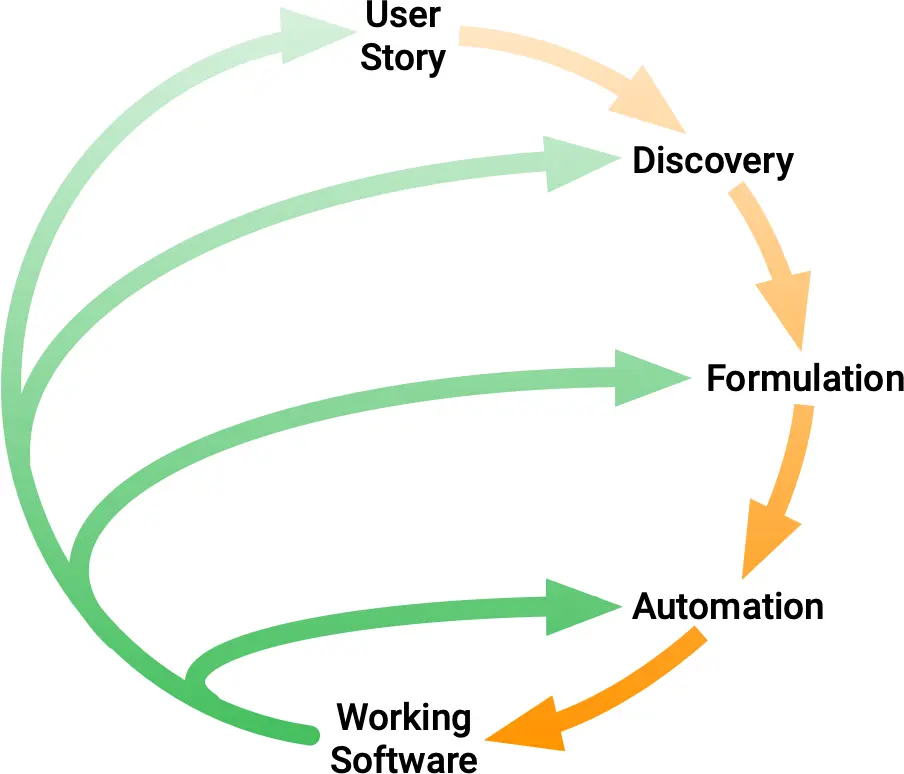
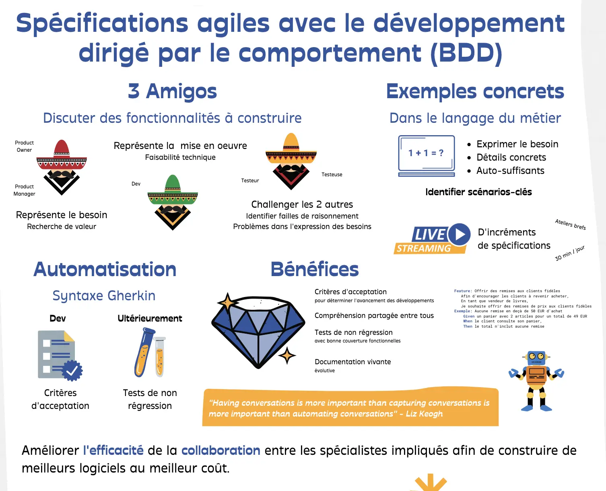
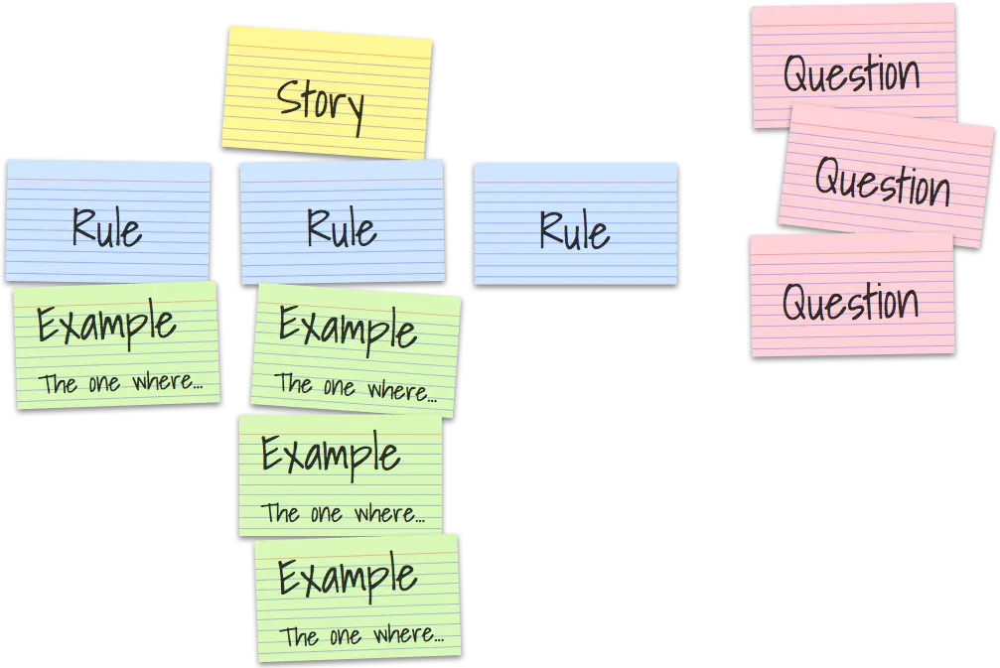
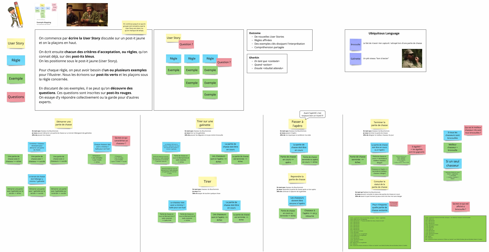
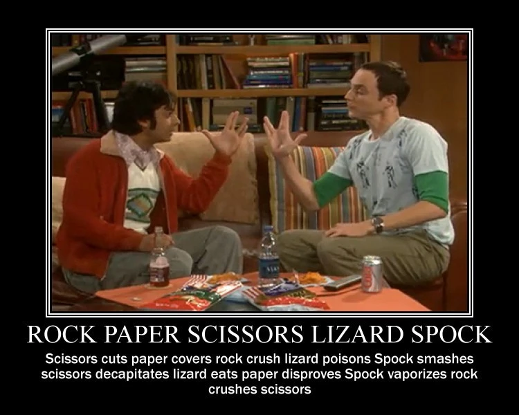
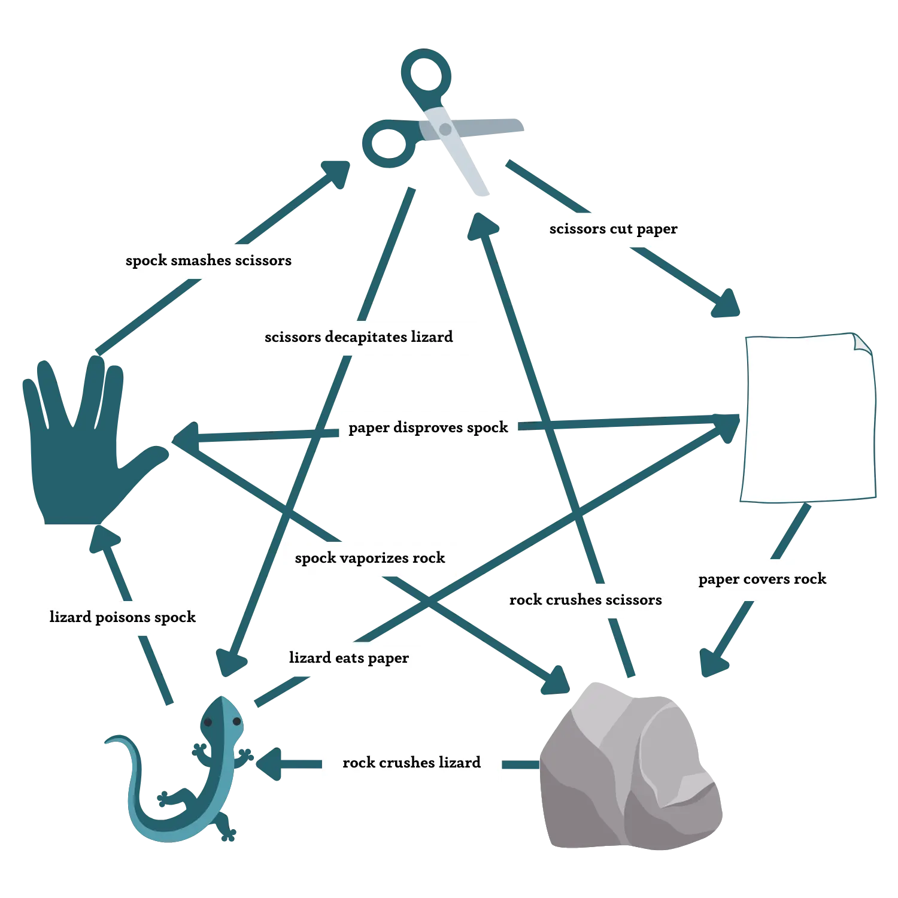

# Behavior-Driven <mark>Development</mark>

Construire la bonne chose, avant de la construire correctement.

---

<span class="kicker">Connexion · en groupes · ~15'</span>

# Deses'po'rate Housewives

<div class="cols cols--wide-left">
<div>

**Matériel** : crayons de couleur, une feuille A4 par groupe.

**Sprint 1 : "Dessine une maison"** <span class="timer">5'</span>

> La maison doit avoir une porte, un toit, un garage, des fenêtres.

- **Production 2'** : chaque groupe "construit"
- **Revue 1'** : chaque groupe présente son résultat
- **Inspection 1'** : qu'est-ce qui diffère entre les dessins ? Pourquoi ?

</div>
<div>



</div>
</div>

<Exercise path="03.bdd/exercices/desporate-housewives" tag="Facilitation" />

---

<span class="kicker">Connexion · Deses'po'rate Housewives</span>

# Sprint 2 : "Dessine MA maison" <span class="timer">5'</span>

> Deux étages (rez-de-chaussée et premier), un garage pour un véhicule, toutes les fenêtres identiques.
> - **Rez-de-chaussée** : la porte d'entrée est verte, une fenêtre est placée à gauche
> - **Premier étage** : deux fenêtres et un toit "hip roof"
> - **Garage** : une porte de garage sectionnelle bleue avec un toit-terrasse

Le client est maintenant **disponible** si les groupes ont des questions.

- **Production 2'**
- **Revue 1'**

---

<span class="kicker">Connexion · Ubiquitous Language</span>

# Une porte sectionnelle ? Un "hip roof" ?

<div class="cols">
<div>

Une **porte de garage sectionnelle** est constituée de panneaux distincts qui s'ouvrent verticalement.


</div>
<div>

Les différents types de toitures :



</div>
</div>

---

<span class="kicker">Connexion · débriefing 3'</span>

# Ce qu'on a vécu

| Ce qu'on a vécu                                        | Ce que BDD adresse                                                             |
|--------------------------------------------------------|--------------------------------------------------------------------------------|
| Sprint 1 : chaque équipe a livré une maison différente | Sans critères d'acceptance, chacun implémente *sa* vision                      |
| Le client absent = interprétations divergentes         | **Disponibilité du PO** : les 3 Amigos réunissent les perspectives *avant* le code |
| "Porte sectionnelle" ? "Toit à 4 pentes" ?             | **Langage ubiquitaire** : Gherkin force à nommer les concepts précisément      |
| Sprint 2 : le résultat converge sans effort de code    | Des critères d'acceptance précis : des scénarios Given/When/Then               |
| On peut finir avant la fin du temps                    | Pas de sur-ingénierie : livrer ce qui est demandé, rien de plus                |

> La carte du Sprint 1 ressemble à un ticket Jira sans acceptance criteria. Celle du Sprint 2, à un scénario Gherkin. Les 3 Amigos transforment la première en deuxième.

---

<span class="kicker">Concepts</span>

# Le cycle BDD : deux boucles imbriquées

<div class="cols cols--wide-right">
<div>

`BDD` ne remplace pas `TDD`, il l'enveloppe.

- **Boucle externe (BDD)** : un test d'acceptance qui échoue, puis on plonge dans TDD, puis on remonte
- **Boucle interne (TDD)** : Red → Green → Refactor, piloté par des tests unitaires

BDD : **"construit-on la bonne chose ?"**
TDD : **"la construit-on correctement ?"**

</div>
<div>



</div>
</div>

---

<span class="kicker">Concepts</span>

# Discovery, Formulation, Automation



---

<span class="kicker">Concepts</span>

# Les 3 Amigos : s'aligner avant de coder

| Rôle             | Question qu'il porte                             | Ce qu'il apporte                                    |
|------------------|--------------------------------------------------|-----------------------------------------------------|
| **Développeur**  | *Comment allons-nous le construire ?*            | Faisabilité technique, contraintes d'implémentation |
| **Testeur / QA** | *Comment allons-nous vérifier que c'est juste ?* | Cas limites, scénarios d'échec, edge cases          |
| **Métier / PO**  | *Qu'est-ce qu'on veut vraiment ?*                | Règles métier, intention, valeur attendue           |

> Pas forcément 3 personnes : c'est une posture. S'assurer que ces trois regards sont présents avant qu'une ligne de code soit écrite.

> **Piège courant** : faire les 3 Amigos *après* le développement, en guise de recette. À ce stade, les malentendus coûtent dix fois plus cher.

---

<span class="kicker">Concepts</span>

# Spécifier ensemble



---

<span class="kicker">Concepts</span>

# Example Mapping : structurer la conversation

<div class="cols">
<div>

Une session de 30 à 45' :

1. Le/La PO lit la story à voix haute (jaune)
2. On identifie les règles métier (bleu)
3. Pour chaque règle, des exemples concrets (vert) : *"Donne-moi un exemple où cette règle s'applique"*
4. Les zones d'ombre deviennent des questions (rouge)
5. Trop de règles ou de questions ? La story est trop grande : on la découpe

</div>
<div>



> Les cartes rouges sont le signe de qualité d'une session. Sans questions, on n'a pas assez creusé.

</div>
</div>

---

<span class="kicker">Concepts · Example Mapping</span>

# Exemple : un code promo e-commerce

```text
🟡  L'utilisateur peut appliquer un code promo à sa commande

🔵  Un code valide réduit le montant du panier
🟢  Code "WELCOME10" (10%) + panier 50€ → remise 5€ → total 45€
🟢  Code "FLAT5" (5€ fixe) + panier 20€ → total 15€

🔵  Un code expiré est refusé
🟢  Code expiré depuis hier → message d'erreur, aucune remise
🟢  Code expirant aujourd'hui à minuit → encore valide à 23h59

🔵  Un code ne peut être utilisé qu'une seule fois par compte
🟢  Second usage du même code → refus avec message explicite
🟢  Même code utilisé par un autre compte → autorisé

🔵  Un code ne s'applique pas sur les articles déjà en promotion
🟢  1 article normal + 1 article soldé → remise sur le normal seulement
🔴  Et si tout le panier est soldé ? Refus silencieux ou message ?
🔴  Un code peut-il être cumulé avec un bon de fidélité ?
```

---

<span class="kicker">Concepts · Example Mapping</span>

# Exemples de sessions

<div class="cols">
<div>



</div>
<div>


</div>
</div>

- Laisser un temps de réflexion individuelle avant la discussion de groupe
- Capturer l'**Ubiquitous Language** : nommer et définir chaque ambiguïté
- S'arrêter quand le périmètre est clair, ou quand le temps est écoulé

> L'outcome n'est pas un document. C'est une **compréhension partagée**.

---

<span class="kicker">Concepts</span>

# Gherkin : des scénarios lisibles

<div class="cols cols--wide-left">
<div>

```gherkin
Feature: Appliquer un code promo sur une commande

  Scenario: Code de remise en pourcentage valide
    Given un panier d'un montant de 50€
    And le code promo "WELCOME10" offre une remise de 10%
    When l'utilisateur applique le code "WELCOME10"
    Then le montant du panier est de 45€

  Scenario: Code expiré refusé
    Given un panier d'un montant de 30€
    And le code promo "SUMMER" a expiré hier
    When l'utilisateur applique le code "SUMMER"
    Then le panier n'est pas modifié
    And un message d'erreur "Code promo expiré" est affiché
```

</div>
<div>

| Mot-clé | Rôle               | AAA     |
|---------|--------------------|---------|
| `Given` | Contexte initial   | Arrange |
| `When`  | Action             | Act     |
| `Then`  | Résultat observable | Assert |

> ⚠️ Un scénario = une action = un comportement. Deux `When` ? Deux scénarios.

</div>
</div>

---

<span class="kicker">Concepts</span>

# De Gherkin au code : les step definitions

```typescript
import { Given, When, Then } from '@cucumber/cucumber';

let montantPanier: number;
let resultat: { montant: number; erreur?: string };

Given('un panier d\'un montant de {int}€', (montant: number) => {
  montantPanier = montant;
});

When('l\'utilisateur applique le code {string}', (code: string) => {
  resultat = appliquerCodePromo(montantPanier, code);
});

Then('le montant du panier est de {int}€', (montantAttendu: number) => {
  expect(resultat.montant).toBe(montantAttendu);
});
```

> Les step definitions ne contiennent **aucune logique métier** : elles sont la colle entre le langage naturel et le code. La logique vit dans le code de production, testé par TDD.

---

<span class="kicker">Pratique concrète · groupes de 3</span>

# Rock Paper Scissors Lizard Spock

<div class="cols cols--wide-left">
<div>

### Exercice 1 : Example Mapping

> *En tant que joueur, je veux savoir qui a gagné une manche, afin de pouvoir arbitrer une dispute avec un ami.*

1. Un développeur, un testeur, un "PO"
2. Identifiez les règles métier (🔵)
3. Au moins 2 exemples concrets par règle (🟢)
4. Notez toutes les questions ouvertes (🔴), sans les résoudre

</div>
<div>



</div>
</div>

<Exercise path="03.bdd/exercices/rock-paper-scissors" />

---

<span class="kicker">Pratique concrète · Rock Paper Scissors Lizard Spock</span>

# Exercice 2 : implémenter en BDD

<div class="cols cols--wide-left">
<div>

Un scénario Gherkin d'abord, le code ensuite.

1. Ouvre le squelette de ton langage (`java/`, `csharp/` ou `ts/`)
2. Écris **1 scénario** dans le `feature file`
3. Lance les tests : ils doivent être **rouges**
4. Implémente les step definitions (la colle)
5. Implémente le code de production (boucle TDD interne)
6. Refactore si nécessaire

**Critères** : les 10 combinaisons gagnantes et l'égalité couvertes, aucune logique métier dans les steps.

</div>
<div>



</div>
</div>

---

<span class="kicker">Concepts</span>

# BDD à plusieurs niveaux

<div class="cols">
<div>

Le même scénario Gherkin peut piloter des tests à différents niveaux. Seule la couche d'implémentation change.

```text
          ┌─────────────┐
          │     E2E     │  Playwright, Selenium…
         ┌┴─────────────┴┐
         │      API      │  RestAssured, SuperTest…
        ┌┴───────────────┴┐
        │   Intégration   │  Spring, TestContainers…
       ┌┴─────────────────┴┐
       │      Unitaire     │  JUnit, vitest, xUnit…
       └───────────────────┘
```

</div>
<div>

> La règle : **utilise le niveau le plus bas qui valide le comportement métier**.

```gherkin
Feature: Connexion utilisateur

  Scenario: Connexion avec des identifiants valides
    Given je suis sur la page de connexion
    When je saisis l'email "alice@example.com"
      et le mot de passe "s3cr3t"
    And je clique sur "Se connecter"
    Then je suis redirigé vers mon tableau de bord
```

</div>
</div>

---

<span class="kicker">Concepts · BDD à plusieurs niveaux</span>

# E2E avec Playwright

```typescript
import { Given, When, Then, Before } from '@cucumber/cucumber';
import { chromium, Page } from 'playwright';

let page: Page;

Before(async () => { page = await (await chromium.launch()).newPage(); });

Given('je suis sur la page de connexion', async () => {
  await page.goto('/login');
});

When('je saisis l\'email {string} et le mot de passe {string}', async (email: string, password: string) => {
  await page.fill('[data-testid="email"]', email);
  await page.fill('[data-testid="password"]', password);
});

When('je clique sur {string}', async (label: string) => {
  await page.getByRole('button', { name: label }).click();
});

Then('je suis redirigé vers mon tableau de bord', async () => {
  expect(page.url()).toContain('/dashboard');
});
```

---

<span class="kicker">Concepts · BDD à plusieurs niveaux</span>

# API avec Spring Boot

<div class="cols cols--wide-right">
<div>

```gherkin
Feature: Gestion du panier

  Scenario: Ajouter un article au panier
    Given un catalogue contenant
      l'article "Clavier mécanique" à 89€
    When j'envoie une requête POST sur
      "/cart/items" avec l'article
      "Clavier mécanique"
    Then la réponse a le statut 201
    And le panier contient 1 article
    And le total du panier est de 89€
```

</div>
<div>

```java
@CucumberContextConfiguration
@SpringBootTest(webEnvironment = RANDOM_PORT)
public class CartSteps {
    @Autowired
    private TestRestTemplate restTemplate;
    private ResponseEntity<CartResponse> response;

    @When("j'envoie une requête POST sur {string} avec l'article {string}")
    public void jEnvoieUneRequetePOST(String path, String article) {
        response = restTemplate.postForEntity(
            path, new AddItemRequest(article), CartResponse.class);
    }

    @Then("la réponse a le statut {int}")
    public void laReponseALeStatut(int expected) {
        assertThat(response.getStatusCode().value())
            .isEqualTo(expected);
    }
}
```

</div>
</div>

---

<span class="kicker">Conclusions</span>

# Et maintenant ?

Qu'est-ce que je pourrais expérimenter dans mon contexte ?

### Ressources

- [Des'po'rate housewives](https://play14.org/games/desporate-housewives)
- [Introducing Example Mapping](https://cucumber.io/blog/bdd/example-mapping-introduction/)
- [Specification by Example](https://gojko.net/books/specification-by-example/)
- [Advent Of Craft challenge](https://github.com/advent-of-craft/2024/blob/main/docs/day18/challenge.md)
