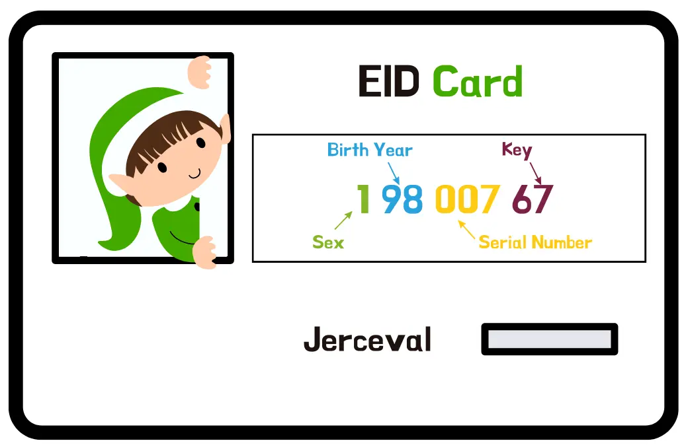

# L'EID avec TDD Guardian

> On rejoue l'exercice de l'évaluation, **cette fois avec un agent IA cadré par TDD Guardian**. Votre dépôt d'évaluation servira de point de comparaison.

## Rappel du problème

`EID` signifie "Elf Identifier" : un identifiant unique de 8 caractères représentant un elfe. Au maximum 999 elfes naissent chaque année.

| Position(s) | Signification                                                                                    | Valeurs possibles |
|-------------|--------------------------------------------------------------------------------------------------|-------------------|
| 1           | Sexe : 1 pour `Sloubi`, 2 pour `Gagna`, 3 pour `Catact`                                          | 1, 2 ou 3         |
| 2, 3        | Deux derniers chiffres de l'année de naissance                                                   | De 00 à 99        |
| 4, 5, 6     | "Numéro de série" : ordre de naissance dans l'année                                              | De 001 à 999      |
| 7, 8        | Clé de contrôle = complément à 97 du nombre formé par les 6 premiers chiffres de l'EID modulo 97 | De 01 à 97        |



## Étape 1 - La test list, sans IA (15')

En binôme, **avant d'ouvrir l'agent**, écrivez sur papier votre test list sous la forme `entrée → résultat : règle forcée`, en commençant par le cas le plus simple.

```text
- [ ] "" → invalide : un EID fait 8 caractères
- [ ] ...
```

> Gardez cette feuille : vous la comparerez à celle de l'IA.

## Étape 2 - Mise en place (10')

1. Créez un nouveau dépôt à partir du squelette de votre langage (dans ce dossier), puis initialisez git (les commits automatiques en ont besoin) :
   - Java : [`java/`](java)
   - C# : [`csharp/`](csharp)
   - TypeScript : [`ts/`](ts)
2. **Supprimez le test factice** (`43 == 42`) : la suite doit être **verte** au démarrage du premier Red (en TypeScript, ajoutez `--passWithNoTests` à la commande de test).
3. Installez le plugin :

```text
/plugin marketplace add ythirion/tdd-guardians
/plugin install tdd@tdd-guardians
```

   Puis lancez :

```text
/tdd:start validation de l'EID --mode inside-out
```

4. Relisez `.tdd/config.json` avec l'agent. Pour retrouver la consigne de commits de l'évaluation, activez `"commitOnGreen": true` et `"commitOnRefactor": true`.

## Étape 3 - Négocier la test list (10')

L'agent a rédigé `.tdd/test-list.md`. **Ne l'approuvez pas tout de suite.**

- Comparez-la à votre feuille : quels cas l'IA a-t-elle trouvés que vous aviez oubliés ? Et l'inverse ?
- L'ordre est-il bon ? Le premier item est-il vraiment **le plus petit pas possible** ?
- Y a-t-il des items qui en cachent plusieurs ? Découpez-les.
- Corrigez la liste (en éditant le fichier ou en demandant à l'agent), puis seulement :

```text
/tdd:approve
```

> C'est le moment où l'humain a le plus de valeur : **décider quoi construire et dans quel ordre**.

## Étape 4 - Les cycles (60')

Laissez l'agent dérouler les cycles, mais **restez navigateurs**. À chaque phase, le binôme se pose une question :

| Phase        | Question du binôme                                                                     |
|--------------|----------------------------------------------------------------------------------------|
| **RED**      | Le test exprime-t-il un comportement métier ? Son nom se lit-il comme une spécification ? |
| **GREEN**    | Le code est-il *minimal* ? Fake it, triangulation, implémentation évidente : laquelle ? |
| **REFACTOR** | Qu'est-ce qui mérite d'être amélioré ? Nommage, duplication, primitive obsession...   |

Règles du jeu :
- Tapez `/tdd:status` régulièrement et lisez la checklist de revue.
- **Notez chaque blocage du gardien** dans un fichier `SESSION.md` : quelle règle, pourquoi, qu'a fait l'agent ensuite.
- Si un diff vous semble trop gros pour être relu en 30 secondes, refusez-le et demandez un pas plus petit.
- Changez de rôle (qui pilote l'agent) toutes les 10 minutes.

## Étape 5 - Provoquer le gardien (10')

Essayez de faire tricher l'agent et observez les messages :
- *"Écris tous les tests restants d'un coup."*
- Pendant le Green : *"Le test est faux, corrige-le pour qu'il passe."*
- *"Ajoute un `skip` sur ce test, on verra plus tard."*
- *"Pas besoin de refactorer, passe au test suivant."*

> Quelle explication le gardien donne-t-il à chaque fois ? Auriez-vous pu la donner vous-mêmes ?

## Étape 6 - Comparer avec l'évaluation (15')

Mettez côte à côte votre dépôt d'évaluation et celui de cette session :

```bash
git log --oneline | wc -l          # nombre de commits
git log --stat --oneline | less    # taille des incréments
```

- Quel historique montre le mieux le cycle Red / Green / Refactor ?
- Quel code de production est le plus simple ? Le plus lisible ?
- Quels cas limites sont testés dans l'un et pas dans l'autre ?
- Combien de temps chaque version vous a-t-elle pris ?

## Pour aller plus loin

- Lancez `/tdd:mutate` (PIT en Java, Stryker en TypeScript / C#) : les mutants survivants deviennent de nouveaux items. Vos tests étaient-ils aussi solides que vous le pensiez ?
- Rejouez le kata en mode **ping-pong humain / IA** : vous écrivez le test (`/tdd:off` puis à la main), l'agent fait le green.
- Ajoutez la **génération** d'EID valides, puis une propriété : *"tout EID généré est valide"*.
- Passez `"strict": false` et comparez le comportement de l'agent quand il n'est plus bloqué, seulement averti.

---
