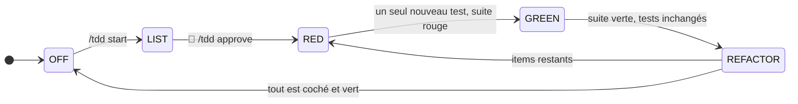
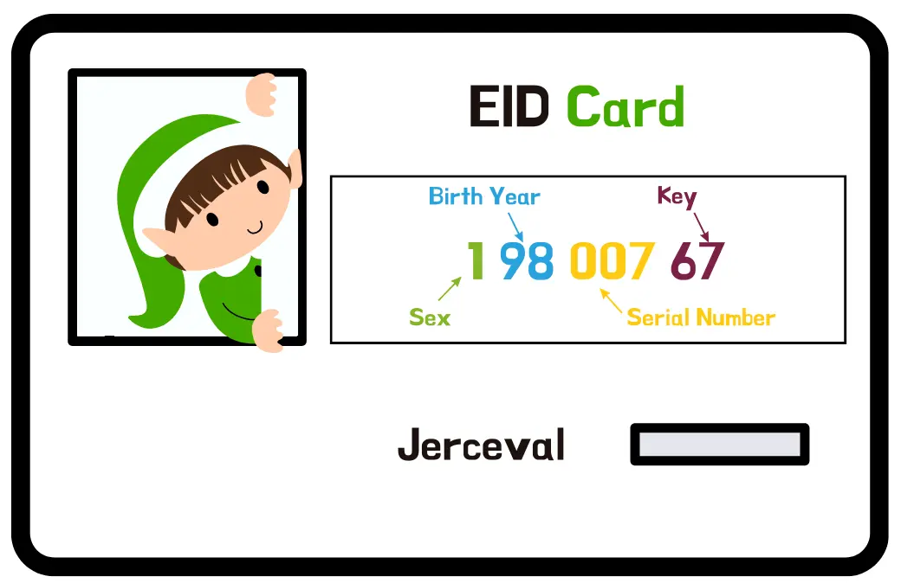

# TDD et IA : <mark>micro-incréments</mark> assistés

L'IA accélère la frappe, pas la réflexion.

---

<span class="kicker">Connexion · en binôme</span>

# Un prompt, et l'agent fait le reste ?

```text
Dans ce dépôt Java (Maven, JUnit 5, AssertJ), implémente en TDD la validation
d'un EID (Elf Identifier) : un identifiant de 8 chiffres.

- Position 1 : sexe, 1 (Sloubi), 2 (Gagna) ou 3 (Catact)
- Positions 2-3 : les deux derniers chiffres de l'année de naissance, de 00 à 99
- Positions 4-6 : numéro de série (ordre de naissance dans l'année), de 001 à 999
- Positions 7-8 : clé de contrôle = 97 - (nombre formé par les 6 premiers chiffres % 97),
  de 01 à 97
- Exemple valide : 19800767

Le cycle TDD doit être lisible dans git : un commit par étape, préfixé red:, green: ou refactor:.
```

<div class="cols">
<div>

Lancez ce prompt **tel quel** dans le CLI (Claude Code, Copilot CLI...), puis observez ce que l'agent produit.

</div>
<div>

- Combien de tests avant le premier code ? Combien de commits, de quelle taille ?
- Les tests sont-ils écrits **avant** le code... ou en même temps ?
- Qu'êtes-vous capables de relire sérieusement ?

</div>
</div>

---

<span class="kicker">Concepts</span>

# Un agent laissé seul avec le TDD

Il *connaît* le TDD, mais optimise pour une seule chose : **arriver au vert le plus vite possible**.

| Dérive                                             | Pourquoi c'est un problème                                                           |
|----------------------------------------------------|--------------------------------------------------------------------------------------|
| Tests et code écrits **dans la même réponse**      | Test *tautologique* : il vérifie ce que le code fait, pas ce qu'il doit faire        |
| 10 tests d'un coup, puis tout le code              | Plus de boucle de feedback, plus de design émergent, plus de triangulation           |
| Test modifié, assertion affaiblie ou `skip` ajouté | Le vert est obtenu en trichant sur la spécification                                  |
| Refactoring sauté dès que c'est vert               | La dette s'accumule à la vitesse de génération de l'IA                               |
| Mocks partout                                      | Tests couplés à l'implémentation, fragiles au refactoring                            |
| Implémentation "complète" dès le premier test      | Sur-ingénierie : du code qu'aucun test n'a demandé                                   |

---
layout: statement
---

# Les baby steps comptent <mark>encore plus</mark> avec l'IA.

---

<span class="kicker">Concepts · pourquoi les baby steps</span>

# 1. Le goulot, c'est la relecture

L'IA écrit 300 lignes en 10 secondes. Toi, tu relis sérieusement **5 lignes**.

| Gros incrément IA                       | Micro-incrément IA                            |
|-----------------------------------------|-----------------------------------------------|
| Diff de 300 lignes, "LGTM" par fatigue  | Diff de 5 lignes, relu et compris             |
| Erreur détectée tard, cause introuvable | Erreur détectée immédiatement, cause évidente |
| Revert = perdre une heure de travail    | Revert = perdre 30 secondes (cf. TCR)         |
| Tu "valides" du code                    | Tu **décides** du prochain comportement       |

> Le développeur passe de *rédacteur* à **pilote et relecteur**. La taille des incréments se calibre sur sa capacité de relecture, pas sur la vitesse de l'IA.

---

<span class="kicker">Concepts · pourquoi les baby steps</span>

# 2. Le test rouge est le meilleur prompt

Un prompt en langage naturel est ambigu. Un test qui échoue ne l'est pas :

```text
❌ "Gère la clé de contrôle de l'EID"
✅ "Fais passer ce test, avec le code le plus simple possible :"
    "198007ZZ" → invalide : la clé doit être composée de chiffres
```

Plus le pas est petit, plus la spécification est précise, moins l'IA a de place pour **inventer**.

### 3. Petit contexte = moins d'hallucinations

Une tâche minuscule tient dans un contexte focalisé : un test, un message d'erreur, un fichier.

### 4. Celui qui écrit le test n'écrit pas le code

C'est le **ping-pong** du pair programming. Avec l'IA, il devient vital : un test écrit avec son code ne prouve rien.

---
class: dense
---

<span class="kicker">Concepts</span>

# Qui fait quoi, à chaque phase ?

| Phase         | Ce qui se décide                        | Humain                                    | IA                                         |
|---------------|-----------------------------------------|-------------------------------------------|--------------------------------------------|
| **Test list** | Quels comportements, dans quel ordre ?  | Valide, réordonne, complète (**gate**)    | Propose une première liste d'exemples      |
| **Red**       | Quel est le *prochain plus petit* pas ? | Choisit l'item, relit l'intention du test | Écrit **un seul** test qui échoue          |
| **Green**     | Le code minimal                         | Vérifie qu'il n'y a rien en trop          | Fait passer le test, sans toucher au test  |
| **Refactor**  | Le design                               | Décide si c'est assez propre              | Propose des refactorings, tests verts      |
| **Commit**    | Le point de sauvegarde                  | Relit le diff                             | Commite                                    |

1. **Ping-pong humain / IA** : tu écris le rouge, l'IA fait le vert. Idéal pour apprendre.
2. **IA testeuse, humain arbitre** : l'IA propose le test, tu relis son intention.
3. **Agents séparés** : testeur, implémenteur (sans la test list), refactoreur. L'humain valide.

---

<span class="kicker">Concepts</span>

# Les règles qui rendent la combinaison sûre

- **Un seul test à la fois.** Jamais deux tests rouges.
- **Le code de test est gelé pendant le Green.** Si le test doit changer, on revient en Red.
- **Un commit par étape**, pour un cycle lisible (et réversible) dans `git log`.
- **Si c'est trop gros, on revert et on découpe.** Pas de "on corrige pour que ça passe".
- **Le Refactor n'est pas optionnel.** C'est là que l'humain reprend la main sur le design.

> **Les garde-fous doivent être dans l'outil, pas dans le prompt.** *"Respecte le TDD"* dans un prompt, c'est une demande. Il faut un mécanisme qui **bloque** l'écriture interdite.

---

<span class="kicker">Concepts · outil</span>

# TDD Guardian

Un plugin Claude Code (expérimental sur Copilot CLI) qui **impose** Red / Green / Refactor à l'agent :

- une **skill** décrit le processus (test list, Canon TDD, green moves, nommage...)
- des **hooks** bloquent les écritures que la phase courante interdit
- chaque blocage **explique la règle enfreinte**, pourquoi elle existe et quoi faire à la place

```text
/plugin marketplace add ythirion/tdd-guardians
/plugin install tdd@tdd-guardians
```

Prérequis : Node.js 18+ dans le `PATH`.

---

<span class="kicker">Concepts · TDD Guardian</span>

# Les phases



| Phase        | L'agent peut écrire        | Condition de sortie (vérifiée par le script)                |
|--------------|----------------------------|-------------------------------------------------------------|
| **LIST**     | `.tdd/test-list.md`        | Un **humain** tape `/tdd:approve`                           |
| **RED**      | Tests, Fakes, builders     | Exactement **un** nouveau test, suite rouge                 |
| **GREEN**    | Code de production         | Suite verte, **hash du code de test inchangé**              |
| **REFACTOR** | Tout                       | Suite verte, assertions non diminuées, item coché           |

---

<span class="kicker">Concepts · TDD Guardian</span>

# Commandes et agents

<div class="cols cols--wide-left">
<div>

| Commande                     | Qui             |
|------------------------------|-----------------|
| `/tdd:start <feature>`       | humain ou agent |
| `/tdd:approve`               | **humain seul** |
| `/tdd:next`                  | humain ou agent |
| `/tdd:status`                | tout le monde   |
| `/tdd:mutate`                | tout le monde   |
| `/tdd:off`                   | **humain seul** |

</div>
<div>

- `tdd-tester` : écrit **un** test qui échoue (RED)
- `tdd-implementer` : code minimal, **sans voir la test list** (GREEN)
- `tdd-refactorer` : améliore le design (REFACTOR)

> L'implémenteur ne connaît que le test rouge : c'est la 3e règle d'Uncle Bob.

**Limites** : le hook Bash est une heuristique, pas un sandbox. `strict: false` transforme les blocages en avertissements.

</div>
</div>

---

<span class="kicker">Pratique concrète · en binôme</span>

# L'EID avec TDD Guardian

<div class="cols cols--wide-left">
<div>

On rejoue l'exercice de l'évaluation, **avec un agent cadré par TDD Guardian**. Votre dépôt d'évaluation sert de comparaison.

1. La test list, **sans IA** <span class="timer">15'</span>
2. Mise en place <span class="timer">10'</span>
3. Négocier la test list, puis `/tdd:approve` <span class="timer">10'</span>
4. Les cycles, en restant navigateurs <span class="timer">60'</span>
5. Provoquer le gardien <span class="timer">10'</span>
6. Comparer avec l'évaluation <span class="timer">15'</span>

</div>
<div>



</div>
</div>

<Exercise path="04.tdd-ia/exercices/eid-tdd-guardian" />

---

<span class="kicker">Pratique concrète · EID</span>

# Rester navigateurs

| Phase        | Question du binôme                                                                     |
|--------------|----------------------------------------------------------------------------------------|
| **RED**      | Le test exprime-t-il un comportement métier ? Son nom se lit-il comme une spécification ? |
| **GREEN**    | Le code est-il *minimal* ? Fake it, triangulation, implémentation évidente : laquelle ? |
| **REFACTOR** | Qu'est-ce qui mérite d'être amélioré ? Nommage, duplication, primitive obsession...   |

- Tapez `/tdd:status` régulièrement et lisez la checklist de revue
- **Notez chaque blocage du gardien** dans `SESSION.md` : la règle, pourquoi, la réaction de l'agent
- Un diff illisible en 30 secondes ? Refusez-le et demandez un pas plus petit
- Changez de pilote toutes les 10 minutes

---

<span class="kicker">Pratique concrète · EID</span>

# Provoquer le gardien

<div class="cols">
<div>

Essayez de faire tricher l'agent :
- *"Écris tous les tests restants d'un coup."*
- *"Le test est faux, corrige-le pour qu'il passe."*
- *"Ajoute un `skip` sur ce test, on verra plus tard."*
- *"Pas besoin de refactorer, passe au test suivant."*

> Quelle explication le gardien donne-t-il ? Auriez-vous pu la donner vous-mêmes ?

</div>
<div>

### Comparer avec l'évaluation

```bash
git log --oneline | wc -l          # nombre de commits
git log --stat --oneline | less    # taille des incréments
```

- Quel historique montre le mieux le cycle ?
- Quel code est le plus simple, le plus lisible ?
- Quels cas limites sont testés dans l'un et pas dans l'autre ?

</div>
</div>

---

<span class="kicker">Conclusions</span>

# Questions pour la suite

- L'IA a-t-elle rendu les baby steps plus faciles ou plus difficiles à tenir ?
- Qui a pris les décisions de design pendant la session : vous ou l'agent ?
- Qu'est-ce que le gardien vous a appris que vous ne saviez pas déjà ?
- Quelle phase du cycle confieriez-vous à l'IA ? Laquelle garderiez-vous ?

> **L'IA accélère la frappe, pas la réflexion.** Petit test, petit diff, relecture réelle, commit, recommencer.

### Ressources

- [TDD Guardian](https://github.com/ythirion/tdd-guardians) · [Kent Beck : Canon TDD](https://tidyfirst.substack.com/p/canon-tdd)
- [Kent Beck : Augmented Coding, Beyond the Vibes](https://tidyfirst.substack.com/p/augmented-coding-beyond-the-vibes)
