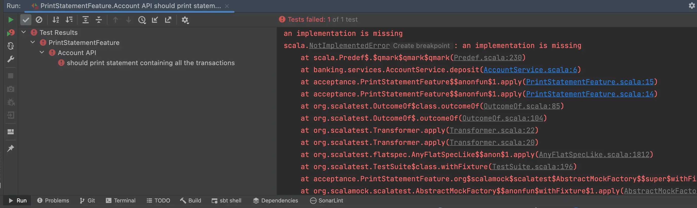
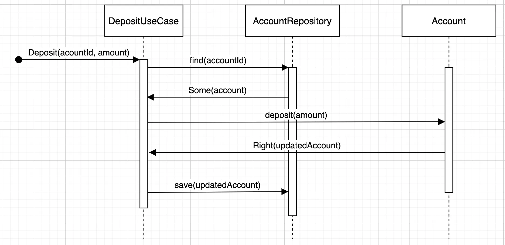
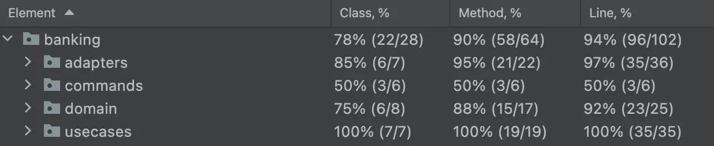

## Bank Kata

### Description du problème

Pensez à votre expérience personnelle avec votre compte bancaire.
En cas de doute, choisissez toujours la solution la plus simple.

Créez un système bancaire simple avec les fonctionnalités suivantes :
- Déposer de l'argent sur un compte
- Retirer de l'argent d'un compte
- Imprimer un relevé de compte en console


### Contraintes

1. Votre système doit supporter les opérations décrites dans le scénario ci-dessous
2. Utilisez `String` pour les erreurs, `UUID` pour les identifiants de compte, `Double` pour les montants (restez simples)
3. Les **Use Cases sont des citoyens de première classe** :
    - Ils prennent une `Command` en entrée et retournent un `Result`
    - Ils ne contiennent qu'une seule méthode publique `invoke`

### Scénario d'acceptation

```gherkin
Scénario : Impression du relevé après transactions
  Étant donné qu'un client effectue un dépôt de 1000 le 12-01-2026
  Et un dépôt de 2000 le 18-01-2026
  Et un retrait de 500 le 19-01-2026
  Quand il/elle imprime son relevé de compte
  Alors il/elle voit
  """
  date       |   credit |    debit |  balance
  19-01-2022 |          |   500.00 |  2500.00
  18-01-2022 |  2000.00 |          |  3000.00
  12-01-2022 |  1000.00 |          |  1000.00
  """
```

---

### Étape 1 - Ajouter un test d'acceptation

Créez un package `acceptance` sous `test` et une classe `PrintStatementFeature`.

🔴 Créons le test d'acceptation basé sur le scénario métier :

```scala
class PrintStatementFeature extends AnyFlatSpec with Matchers {
  behavior of "Account API"

  it should "print statement containing all the transactions" in {
    true mustBe false
  }
}
```

Ajoutez les détails du scénario :

```scala
it should "print statement containing all the transactions" in {
    val accountId = UUID.randomUUID()

    depositUseCase.invoke(Deposit(accountId, 1000d))
    depositUseCase.invoke(Deposit(accountId, 2000d))
    withDrawUseCase.invoke(Withdraw(accountId, 500d))

    printStatementUseCase.invoke(PrintStatement(accountId))

    printerStub.verify("date       |   credit |    debit |  balance").once()
    printerStub.verify("19-01-2022 |          |   500.00 |  2500.00").once()
    printerStub.verify("18-01-2022 |  2000.00 |          |  3000.00").once()
    printerStub.verify("12-01-2022 |  1000.00 |          |  1000.00").once()
  }
```

- On génère les **Commands** dans un package `banking.commands` depuis l'usage :

```scala
case class Deposit(accountId: UUID, amount: Double) {}
case class PrintStatement(accountId: UUID) {}
case class Withdraw(accountId: UUID, amount: Double) {}
```

- On génère les **Use Cases** dans un package `banking.usecases` :

```scala
class DepositUseCase() {
  def invoke(deposit: Deposit) = ???
}

class PrintStatementUseCase(printer: String => Unit) {
  def invoke(statement: PrintStatement) = ???
}

class WithdrawUseCase() {
  def invoke(withdraw: Withdraw) = ???
}
```

- On instancie un **stub** pour la fonction d'impression :

```scala
class PrintStatementFeature extends AnyFlatSpec with Matchers with MockFactory {
  behavior of "Account API"

  private val printerStub = stubFunction[String, Unit]

  private val depositUseCase = new DepositUseCase()
  private val withDrawUseCase = new WithdrawUseCase()
  private val printStatementUseCase = new PrintStatementUseCase(printerStub)

  it should "print statement containing all the transactions" in {
    val accountId = UUID.randomUUID()

    depositUseCase.invoke(Deposit(accountId, 1000d))
    depositUseCase.invoke(Deposit(accountId, 2000d))
    withDrawUseCase.invoke(Withdraw(accountId, 500d))

    printStatementUseCase.invoke(PrintStatement(accountId))

    inSequence {
      printerStub.verify("date       |   credit |    debit |  balance").once()
      printerStub.verify("19-01-2022 |          |   500.00 |  2500.00").once()
      printerStub.verify("18-01-2022 |  2000.00 |          |  3000.00").once()
      printerStub.verify("12-01-2022 |  1000.00 |          |  1000.00").once()
    }
  }
}
```

Félicitations - vous avez un **test d'acceptation rouge** qui va guider toute l'implémentation.



---

### Étape 2 - TDD sur le Use Case Dépôt

Réfléchissons aux cas de test pour le dépôt :

```text
Compte inexistant → retourner un échec "Unknown account"
Compte existant → retourner un échec pour un dépôt de 0
Compte existant + dépôt de 1000 → stocker le compte mis à jour avec une transaction positive de 1000
```

Séquence pour le cas passant :



#### Tests non-passants

Le type de retour d'`invoke` sera `Either[String, Account]` (`String` représente une erreur).

🔴 Premier test :

```scala
class DepositShould extends AnyFlatSpec with MockFactory with EitherValues with Matchers {

    it should "return a failure for a non existing account" in {
      val deposit = Deposit(UUID.randomUUID(), 1000)
      val depositUseCase = new DepositUseCase(accountRepositoryStub)

      (accountRepositoryStub.find _)
        .when(deposit.accountId)
        .returns(None)

      depositUseCase.invoke(deposit).left.get mustBe "Unknown account"
    }
}
```

On génère le stub du repository et crée un trait pour lui (port hexagonal) :

```scala
private val accountRepositoryStub = stub[AccountRepository]

trait AccountRepository {
  def find(accountId: UUID): Option[Account]
}
```

On génère `Account` dans `banking.domain` :

```scala
case class Account(id: UUID) {}
```

🟢 Faire passer le test au plus vite :

```scala
def invoke(deposit: Deposit): Either[String, Account] = Left("Unknown account")
```

🔵 Refactoring : rien de nécessaire ici.

🔴 Deuxième test (compte existant, dépôt de 0) :

```scala
  it should "return a failure for an existing account and a deposit of 0" in {
    val deposit = Deposit(UUID.randomUUID(), 0)
    existingAccount()

    depositUseCase.invoke(deposit).left.get mustBe "Invalid amount for deposit"
  }
```

🟢 Faire passer :

```scala
class DepositUseCase(accountRepository: AccountRepository) {
  def invoke(deposit: Deposit): Either[String, Account] =
    accountRepository.find(deposit.accountId) match {
      case Some(account) => Left("Invalid amount for deposit")
      case None          => Left("Unknown account")
    }
}
```

🔵 Refactoring - on centralise les helpers de test et extrait les méthodes :

```scala
class DepositShould extends AnyFlatSpec with MockFactory with EitherValues with Matchers {
  private val accountRepositoryStub = stub[AccountRepository]
  private val anAccountId = UUID.randomUUID()
  private val depositUseCase = new DepositUseCase(accountRepositoryStub)

  private def notExistingAccount(): Unit =
    (accountRepositoryStub.find _).when(anAccountId).returns(None)

  private def existingAccount(): Unit =
    (accountRepositoryStub.find _).when(anAccountId).returns(Some(Account(anAccountId)))
}
```

#### Tests passants

🔴 Test passant : compte existant + dépôt de 1000 → stocker avec une `Transaction` :

```scala
  it should "store the updated account containing a Transaction(transactionTime, 1000) for an existing account and a deposit of 1000" in {
    existingAccount()
    val newAccount = depositUseCase.invoke(depositOf1000)

    newAccount.right.value.transactions must contain(Transaction(transactionTime, 1000))
    (accountRepositoryStub.save _).verify(newAccount.right.value).once()
  }
```

On crée le `Value Object` `Transaction` :

```scala
case class Transaction(at: LocalDateTime, amount: Double) {}
```

On injecte une `Clock` (port) pour contrôler le temps :

```scala
trait Clock {
  def now(): LocalDateTime
}

class DepositUseCase(accountRepository: AccountRepository, clock: Clock) {
  def invoke(deposit: Deposit): Either[String, Account] = {
    accountRepository.find(deposit.accountId) match {
      case Some(account) =>
        account.deposit(clock, deposit.amount) match {
          case Right(updatedAccount) =>
            accountRepository.save(updatedAccount)
            Right(updatedAccount)
          case Left(error) => Left(error)
        }
      case None => Left("Unknown account")
    }
  }
}
```

Implémentation du `deposit` dans `Account` :

```scala
case class Account(id: UUID, transactions: List[Transaction] = List()) {

  def deposit(clock: Clock, amount: Double): Either[String, Account] = {
    if (amount <= 0) Left("Invalid amount for deposit")
    else Right(copy(transactions = Transaction(clock.now(), amount) :: transactions))
  }
}
```

```text
✅ Compte inexistant → "Unknown account"
✅ Compte existant + dépôt de 0 → "Invalid amount for deposit"
✅ Compte existant + dépôt de 1000 → compte mis à jour avec Transaction(transactionTime, 1000)
```


---

### Étape 3 - TDD sur le Use Case Retrait

Cas de test :

```text
Compte inexistant → retourner un échec "Unknown account"
Compte existant → retourner un échec pour un retrait de 0
Compte existant sans fonds suffisants + retrait de 100 → "Not enough money to withdraw 100.0"
Compte existant avec fonds suffisants + retrait de 900 → stocker le compte avec une transaction négative de 900
```

On centralise le code partagé entre les tests dans un trait `AccountUseCaseTest` :

```scala
trait AccountUseCaseTest extends MockFactory with Matchers {
  protected val anAccountId: UUID = UUID.randomUUID()
  protected val accountRepositoryStub: AccountRepository = stub[AccountRepository]

  protected def notExistingAccount(): Unit =
    (accountRepositoryStub.find _).when(anAccountId).returns(None)

  protected def existingAccount(transactions: Transaction*): Unit =
    (accountRepositoryStub.find _)
      .when(anAccountId)
      .returns(Some(AccountBuilder.aNewAccount(anAccountId).containing(transactions.toList).build()))
}
```

On implémente le retrait dans `Account` avec une fonction de continuation pour éviter la duplication :

```scala
case class Account(id: UUID, transactions: List[Transaction] = List()) {
  def deposit(clock: Clock, amount: Double): Either[String, Account] =
    validateAmount(amount, "Invalid amount for deposit") { validAmount =>
      addTransaction(clock, validAmount)
    }

  def withdraw(clock: Clock, amount: Double): Either[String, Account] =
    validateAmount(amount, "Invalid amount for withdraw") { validAmount =>
      if (!containsEnoughMoney(validAmount))
        Left(s"Not enough money to withdraw $validAmount")
      else addTransaction(clock, -validAmount)
    }

  private def validateAmount(amount: Double, errorMessage: String)(
      onValid: Double => Either[String, Account]
  ): Either[String, Account] =
    if (amount > 0) onValid(amount) else Left(errorMessage)

  private def containsEnoughMoney(amount: Double): Boolean =
    transactions.map(_.amount).sum >= amount

  private def addTransaction(clock: Clock, amount: Double) =
    Right(copy(transactions = Transaction(clock.now(), amount) :: transactions))
}
```

```text
✅ Compte inexistant → "Unknown account"
✅ Compte existant + retrait de 0 → "Invalid amount for withdraw"
✅ Compte existant sans fonds + retrait de 100 → "Not enough money to withdraw 100.0"
✅ Compte existant avec fonds + retrait de 900 → compte mis à jour avec Transaction(transactionTime, -900)
```


> **Cas bonus découvert en cours de route :** que se passe-t-il si on retire exactement le montant disponible ?

---

### Étape 4 - TDD sur le Use Case Impression du relevé

Cas de test :

```text
Compte inexistant → retourner un échec "Unknown account"
Compte existant sans transactions → imprimer un relevé vide (uniquement l'en-tête)
Compte existant avec transactions (+20 078.89, -5890.87, +3678.54) → imprimer le relevé en ordre chronologique inverse
```

On sépare la logique de formatage de la logique métier en créant un `StatementFormatter` (port) et un `ConsoleFormatter` (adaptateur) :

```scala
trait StatementFormatter {
  def format(transactions: List[Transaction]): String
}

case class ConsoleFormatter() extends StatementFormatter {
  private val dateTimeFormatter = ofPattern("dd-MM-yyyy")
  private val decimalFormatter  = new DecimalFormat("#.00")
  private val cellSpace         = 8
  private val header            = "date       |   credit |    debit |  balance"

  override def format(transactions: List[Transaction]): String =
    header + formatTransactions(transactions)

  private def formatTransactions(transactions: List[Transaction]): String =
    if (transactions.isEmpty) ""
    else lineSeparator() + toStatementLines(transactions)

  private def toStatementLines(transactions: List[Transaction]): String =
    transactions.zipWithIndex
      .map { case (t, i) => toLine(t, balanceFor(transactions, i)) }
      .mkString(lineSeparator())

  private def toLine(t: Transaction, balance: Double): String =
    s"${formatDate(t.at)} | ${amountOrEmpty(t.amount, _ > 0)} | ${amountOrEmpty(t.amount, _ < 0)} | ${formatAmount(balance)}"

  private def balanceFor(transactions: List[Transaction], index: Int): Double =
    transactions.drop(index).map(_.amount).sum

  private def amountOrEmpty(amount: Double, cond: Double => Boolean): String =
    if (cond(amount)) formatAmount(Math.abs(amount)) else emptyCell()

  private def formatAmount(amount: Double): String =
    prefixWithSpace(decimalFormatter.format(amount), cellSpace)

  private def formatDate(date: LocalDateTime): String =
    dateTimeFormatter.format(date)

  private def emptyCell(): String = " " * cellSpace

  private def prefixWithSpace(str: String, size: Int): String =
    " " * (size - str.length) + str
}
```

On supprime la duplication entre les Use Cases grâce à un trait partagé :

```scala
trait AccountUseCase {
  protected def invokeWhenAccountExists[TResult](
      accountRepository: AccountRepository,
      accountId: UUID,
      onSuccess: Account => Either[String, TResult]
  ): Either[String, TResult] =
    accountRepository.find(accountId) match {
      case Some(account) => onSuccess(account)
      case None          => Left("Unknown account")
    }
}
```

```text
✅ Compte inexistant → "Unknown account"
✅ Compte sans transactions → en-tête uniquement
✅ Compte avec transactions → relevé en ordre chronologique inverse
```


---

### Étape 5 - Faire passer le test d'acceptation

Notre test d'acceptation est encore rouge. On adapte le test pour refléter les décisions prises lors de l'implémentation (le relevé est imprimé en une seule fois) :

```scala
printerStub
  .verify(
    """date       |   credit |    debit |  balance
      |19-01-2022 |          |   500.00 |  2500.00
      |18-01-2022 |  2000.00 |          |  3000.00
      |12-01-2022 |  1000.00 |          |  1000.00""".stripMargin
  )
  .once()
```

On utilise un `AccountRepositoryFake` pour simuler la persistance en mémoire :

```scala
class AccountRepositoryFake(val existingAccounts: UUID*) extends AccountRepository {
  private val inMemoryAccounts: mutable.Map[UUID, Account] = mutable.Map[UUID, Account]()
  existingAccounts.foreach(id => inMemoryAccounts(id) = aNewAccount(id).build())

  override def find(accountId: UUID): Option[Account] = inMemoryAccounts.get(accountId)
  override def save(account: Account): Unit = inMemoryAccounts.update(account.id, account)
}
```

Test d'acceptation final :

```scala
class PrintStatementFeature extends AnyFlatSpec with Matchers with MockFactory {
  behavior of "Account API"

  private val accountId             = UUID.randomUUID()
  private val printerStub           = stubFunction[String, Unit]
  private val clockStub             = stub[Clock]
  private val accountRepositoryFake = new AccountRepositoryFake(accountId)

  private val depositUseCase        = new DepositUseCase(accountRepositoryFake, clockStub)
  private val withDrawUseCase       = new WithdrawUseCase(accountRepositoryFake, clockStub)
  private val printStatementUseCase = new PrintStatementUseCase(accountRepositoryFake, printerStub, ConsoleFormatter())

  it should "print statement containing all the transactions" in {
    onDay(12)(_ => depositUseCase.invoke(Deposit(accountId, 1000d)))
    onDay(18)(_ => depositUseCase.invoke(Deposit(accountId, 2000d)))
    onDay(19)(_ => withDrawUseCase.invoke(Withdraw(accountId, 500d)))

    printStatementUseCase.invoke(PrintStatement(accountId))

    printerStub
      .verify(
        """date       |   credit |    debit |  balance
          |19-01-2022 |          |   500.00 |  2500.00
          |18-01-2022 |  2000.00 |          |  3000.00
          |12-01-2022 |  1000.00 |          |  1000.00""".stripMargin
      )
      .once()
  }

  private def onDay(day: Int)(invoke: Unit => Unit): Unit = {
    (clockStub.now _).when().returns(LocalDateTime.of(2022, 1, day, 0, 0)).noMoreThanOnce()
    invoke(())
  }
}
```

🟢 Le test d'acceptation passe !


---

## Conclusion

### Ce qu'on retient

- Le TDD Outside-In démarre par un **test d'acceptation** qui décrit le comportement observable depuis l'extérieur
- La **double boucle** garantit qu'on ne s'éloigne jamais de l'objectif métier
- Les **Use Cases** comme citoyens de première classe rendent le code lisible comme une spécification
- La **Clean Architecture** permet de tester sans infrastructure réelle tout en restant proche du comportement attendu
- L'approche 2 (Use Cases + Gateways) offre le meilleur compromis robustesse / coût de maintenance

### Impact sur la couverture de code



En codant Outside-In avec des tests d'acceptation + tests de Use Cases, la couverture est un **sous-produit** de la démarche, pas un objectif.
