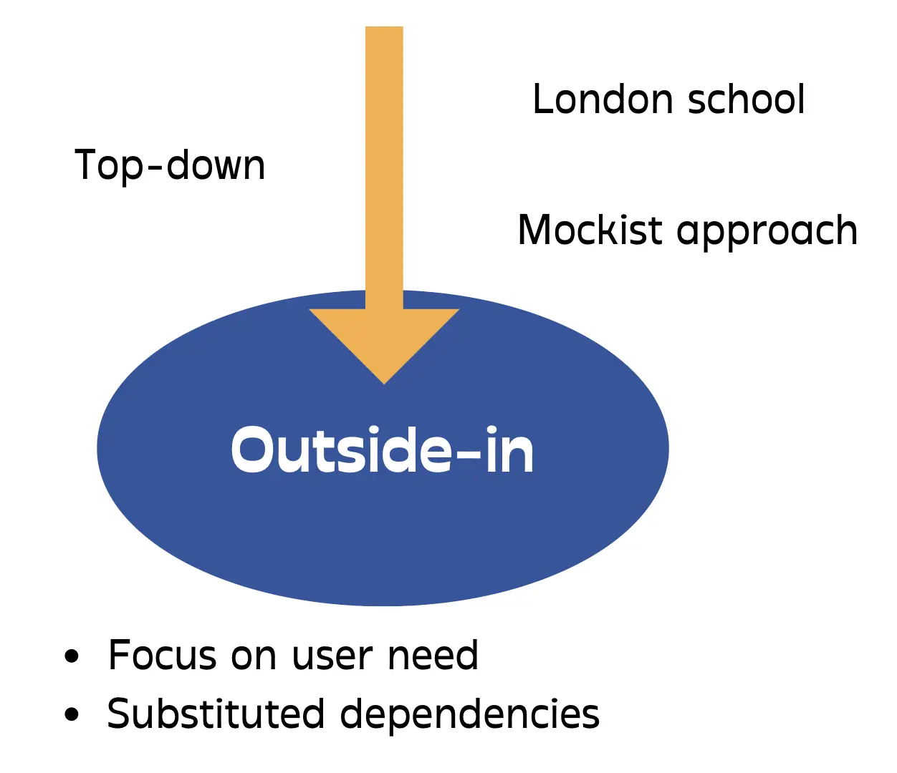
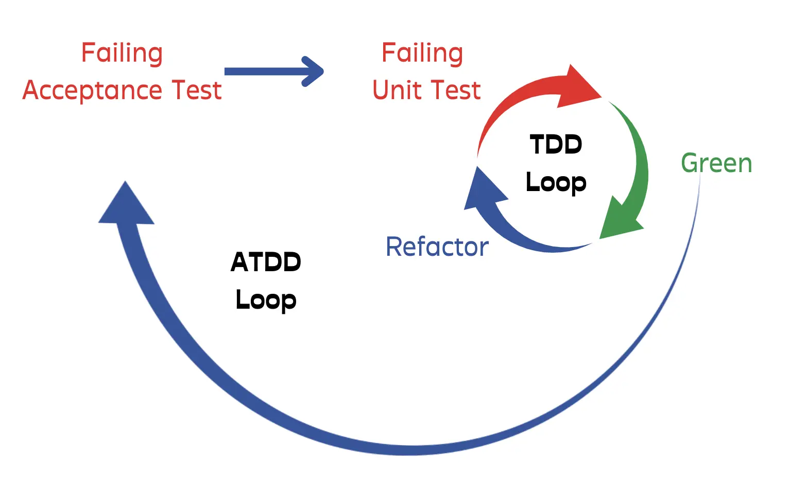
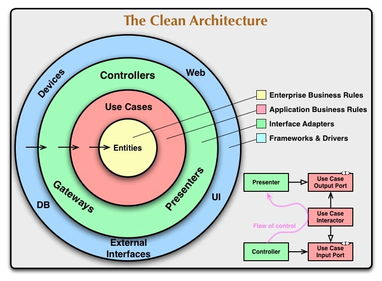
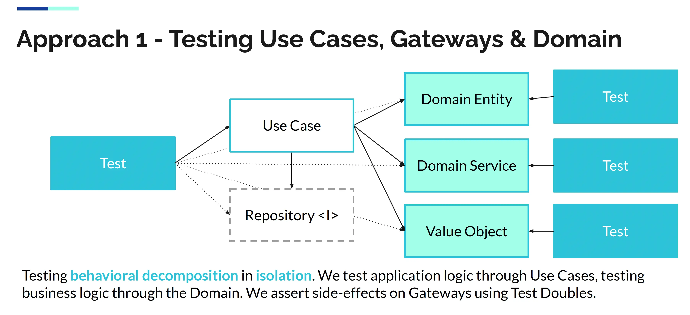
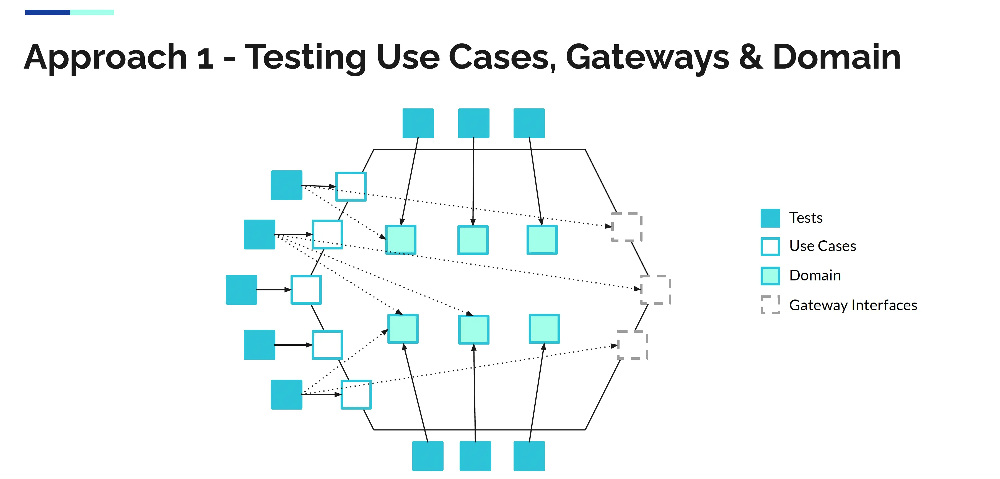
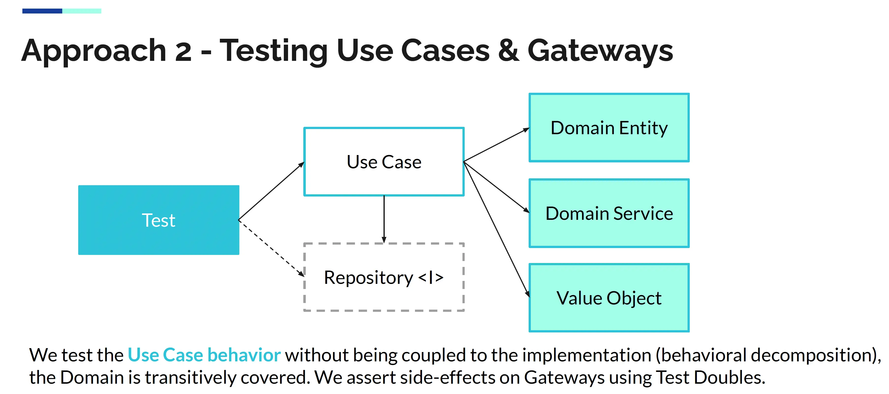
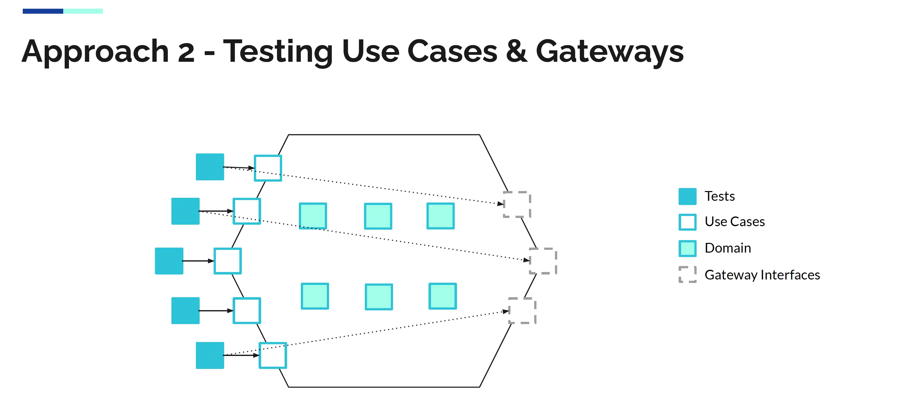
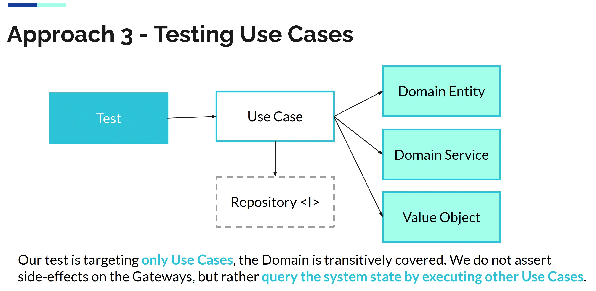
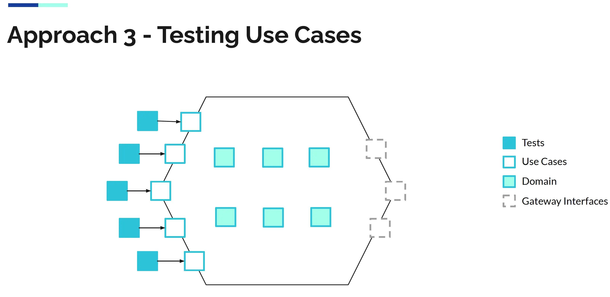

# TDD <mark>Outside-In</mark>

L'école de Londres : partir de l'extérieur du système et descendre couche par couche.

---

<span class="kicker">Connexion · en binôme · 2'</span>

# Par quoi commencez-vous ?

Vous avez pratiqué le TDD `Inside-Out` : on part du domaine et on remonte.

- Quand vous démarrez une nouvelle fonctionnalité, par quoi commencez-vous ?
- Avez-vous déjà eu un composant bien testé unitairement… qui ne fonctionnait pas avec le reste du système ?
- Qu'est-ce qu'un **test d'acceptation** pour vous ?

> Mise en commun, puis on découvre une autre façon de faire du TDD.

---

<span class="kicker">Concepts</span>

# Les deux écoles du TDD

|                     | École Classique (Inside-Out)       | École de Londres (Outside-In)          |
|---------------------|------------------------------------|----------------------------------------|
| **Aussi appelée**   | Chicago / Detroit school           | London school / Mockist TDD            |
| **Point de départ** | Domaine / logique métier           | Interface externe / test d'acceptation |
| **Progression**     | Du bas vers le haut                | Du haut vers le bas                    |
| **Doubles de test** | Utilisés avec parcimonie           | Mocks/stubs pour isoler les couches    |
| **Design émergent** | Structure découverte par les tests | Structure guidée dès le départ         |

Les deux sont valides : leur pertinence dépend du contexte et des habitudes de l'équipe.

---

<span class="kicker">Concepts</span>

# Outside-In : la double boucle

<div class="cols">
<div>



1. **Boucle externe (acceptance)** : un test d'acceptation rouge décrit le comportement visible de l'extérieur
2. **Boucles internes (unit)** : on descend couche par couche en TDD jusqu'à le faire passer

</div>
<div>



> Le test d'acceptation rouge **guide** toute l'implémentation. On ne s'arrête que quand il passe au vert.

</div>
</div>

---

<span class="kicker">Concepts</span>

# Clean Architecture

<div class="cols cols--wide-right">
<div>

- Les **Use Cases** sont des citoyens de première classe : un Use Case par comportement métier
- Ils prennent une **Command** et retournent un **Result**
- Une seule méthode publique : `invoke`
- Les **Gateways / Repositories** sont des ports (interfaces), leurs implémentations des adaptateurs

</div>
<div>



</div>
</div>

---

<span class="kicker">Concepts · tester les Use Cases</span>

# Trois approches

<div class="cols cols--wide-left">
<div>

1. Tester **Use Cases, Gateways et Domaine** séparément
2. Tester **Use Cases et Gateways**
3. Tester **uniquement les Use Cases**

Inspiré du talk de Valentina Cupać au Software Craft Luxembourg Meetup.

</div>
<div>

<a href="https://youtu.be/IZWLnn2fNko"></a>

</div>
</div>

---

<span class="kicker">Tester les Use Cases · approche 1</span>

# Use Cases, Gateways et Domaine séparément

<div class="cols">
<div>




</div>
<div>

✅ Décomposition comportementale au grain le plus fin, utile pour l'explosion combinatoire ou les domaines mathématiques

❌ On perd la vue d'ensemble du Use Case

❌ Plus de code de test, plus cher à maintenir

❌ Tests couplés à l'implémentation : fragiles au refactoring

</div>
</div>

---

<span class="kicker">Tester les Use Cases · approche 2</span>

# Use Cases et Gateways

<div class="cols">
<div>




</div>
<div>

✅ Cible l'API du système, pas l'implémentation

✅ Tests lisibles comme des spécifications (flux nominaux, flux d'erreur)

✅ Couverture élevée à faible coût

✅ On refactore, on découvre le domaine sans casser les tests

❌ Explosion combinatoire ou complexité mathématique : des tests plus fins peuvent être nécessaires ("changer de vitesse")

</div>
</div>

---

<span class="kicker">Tester les Use Cases · approche 3</span>

# Uniquement les Use Cases

<div class="cols">
<div>




</div>
<div>

✅ Cible uniquement l'API des Use Cases

✅ Tests lisibles comme des specs

✅ Robustesse maximale

❌ Impossible de vérifier les effets de bord non exposés par les Use Cases (timestamps internes, champs non exposés en query)

</div>
</div>

---
layout: statement
---

# Nous recommandons l'<mark>approche 2</mark> : tester les Use Cases et les Gateways.

Couplés à l'API, pas à l'implémentation. Lisibles comme des spécifications. ROI élevé.

---

<span class="kicker">Pratique concrète · en binôme</span>

# Bank Kata

<div class="cols cols--wide-left">
<div>

Un système bancaire simple : **déposer**, **retirer**, **imprimer un relevé** en console.

```gherkin
Scénario : Impression du relevé après transactions
  Étant donné un dépôt de 1000 le 12-01-2026
  Et un dépôt de 2000 le 18-01-2026
  Et un retrait de 500 le 19-01-2026
  Quand il/elle imprime son relevé de compte
  Alors il/elle voit le relevé
```

</div>
<div>


</div>
</div>

<Exercise path="05.tdd-outside-in/exercices/bank-kata" />

---

<span class="kicker">Conclusions</span>

# Questions pour la suite

- Quelle différence avez-vous ressentie entre Inside-Out et Outside-In ?
- Dans quel contexte préféreriez-vous l'une ou l'autre approche ?
- Comment la Clean Architecture a-t-elle influencé la lisibilité du code ?

### Ressources

- [Kata original : Sandro Mancuso](https://github.com/sandromancuso/Bank-kata)
- [Outside-In TDD par Sandro Mancuso (vidéo)](https://youtu.be/XHnuMjah6ps) · [Outside-In TDD en React (vidéo)](https://youtu.be/20jEMBTGVG4)
- [Growing Object-Oriented Software Guided by Tests](http://www.growing-object-oriented-software.com/)
