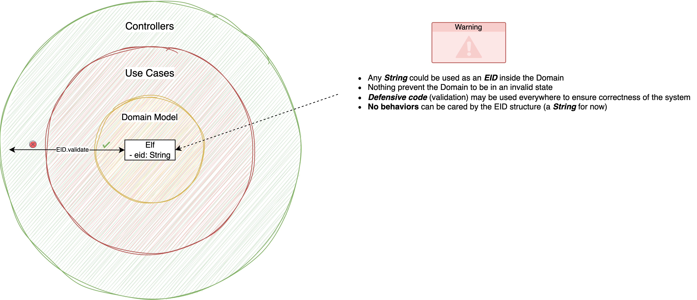
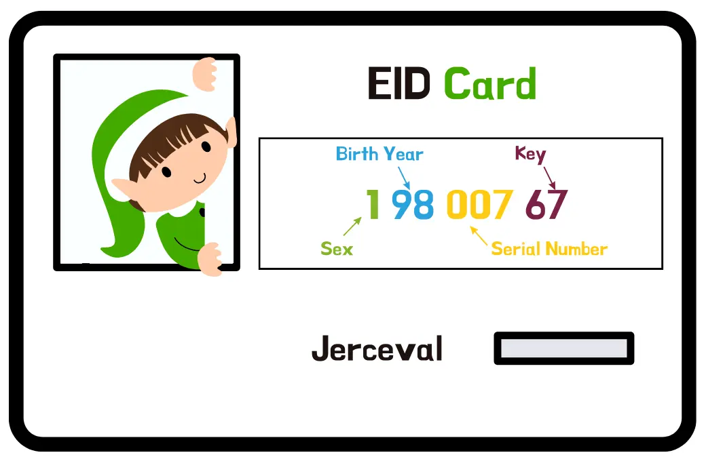

# EID 2 - le retour : Parse Elf IDs

## Limites de la validation



## Rappel des règles

`EID` signifie "Elf Identifier" (Identifiant Elfe) : un identifiant unique représentant un elfe, composé de 8 caractères.
Les elfes sont créés magiquement chaque année, avec un maximum de 999 naissances.

| Position(s) | Signification                                                                                    | Valeurs possibles |
|-------------|--------------------------------------------------------------------------------------------------|-------------------|
| 1           | Sexe : 1 pour `Sloubi`, 2 pour `Gagna`, 3 pour `Catact`                                          | 1, 2 ou 3         |
| 2, 3        | Deux derniers chiffres de l'année de naissance (précision au siècle près)                        | De 00 à 99        |
| 4, 5, 6     | "Numéro de série" : ordre de naissance dans l'année                                              | De 001 à 999      |
| 7, 8        | Clé de contrôle = complément à 97 du nombre formé par les 6 premiers chiffres de l'EID modulo 97 | De 01 à 97        |



## Exercice 1 - Example Mapping

1. Formez des groupes de 3 (un dev, un testeur, un "PO des elfes")
2. Pour chaque sous-type (`Sex`, `Year`, `SerialNumber`, `Key`), identifiez :
   - 🔵 La règle de validité
   - 🟢 Au moins 2 exemples valides et 1 invalide
   - 🔴 Les questions ouvertes (chaîne vide ? trop courte ? non numérique ?)
3. Formulez la propriété `round-trip` en français avant de coder

**Critères de succès** :
- [ ] Chaque type a sa règle, ses exemples et au moins une question
- [ ] La propriété round-trip est formulée en langage naturel
- [ ] Le groupe a identifié l'ordre de construction des types

## Exercice 2 - Parse Elf IDs

Le squelette du kata se trouve dans ce dossier : [`java/`](java), [`csharp/`](csharp), [`ts/`](ts).

**Objectif** : implémenter `String → Either<ParsingError, EID>` en appliquant le `Type-Driven Development`.

1. **Commence par poser un premier test** avant toute implémentation
2. **Fais-le passer en dur** : retourne un EID hardcodé pour avoir un premier vert
3. **Crée `Sex`**, le plus simple (enum à 3 valeurs avec `parse`)
4. **Itère** : `Year`, puis `SerialNumber`, puis la clé de contrôle
5. **Constructeurs privés partout** : chaque type ne peut être créé que par son `parse`
6. **Laisse la propriété guider** : si elle est rouge, `toString` ou `parse` est faux

**Rappel pour la clé :**

```text
clé = 97 - (parseInt(sex + year + serialNumber) % 97)
```

**Critères de succès** :
- [ ] Il est impossible de construire un `EID` invalide sans passer par `EID.parse()`
- [ ] Chaque type a son propre `parse` retournant un `Either`
- [ ] Aucune logique de validation n'existe en dehors des méthodes `parse`
- [ ] La propriété round-trip passe avec au moins 1 000 exemples générés (optionnel)

## Défi bonus : Either composable

`flatMap` sur `Either` permet de chaîner les parsers sans pyramide de conditions :

```typescript
// Au lieu de if/if/if imbriqués :
Sex.parse(raw[0])
  .flatMap(sex => Year.parse(raw.slice(1, 3)).map(year  => ({ sex, year })))
  .flatMap(ctx => SerialNumber.parse(raw.slice(3, 6)).map(sn => ({ ...ctx, sn })))
  .map(ctx     => new EID(ctx.sex, ctx.year, ctx.sn))
```

Implémente `map` et `flatMap` sur ton `Either` et refactorise ton parser pour utiliser ce style.

## Solution

Le guide `step-by-step` est disponible [ici](solution/step-by-step.md).
