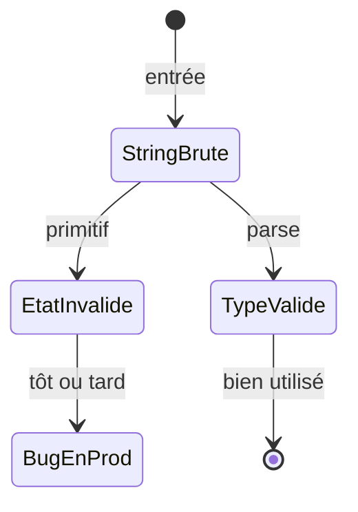
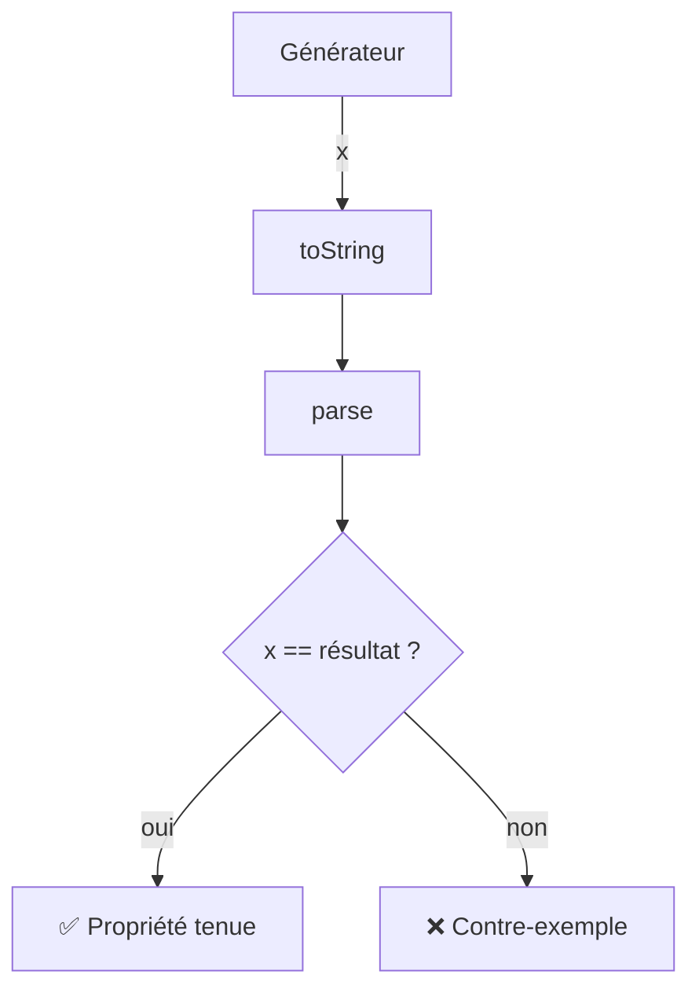
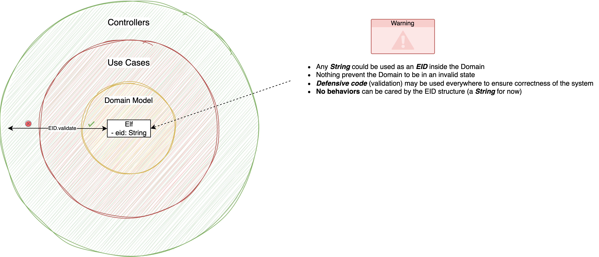
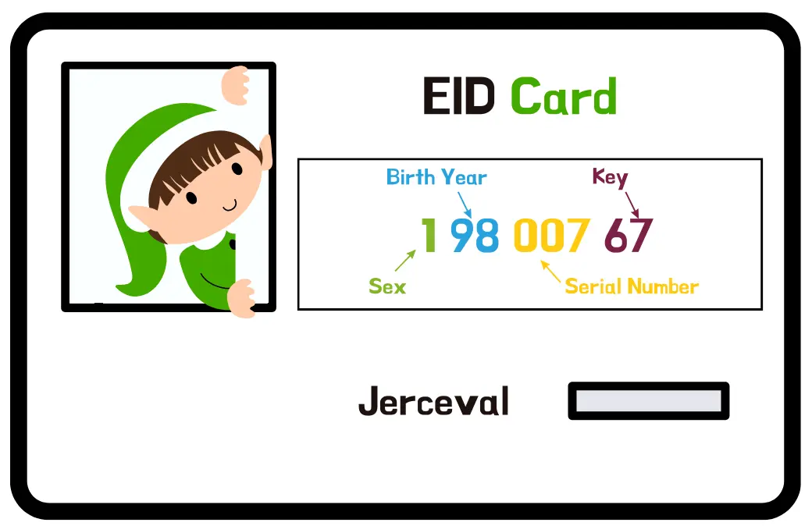
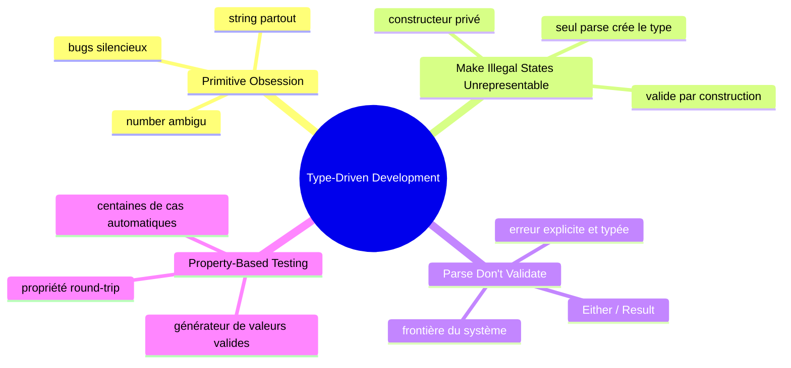

# Type-Driven <mark>Development</mark>

Si ça compile, c'est valide.

---

<span class="kicker">Connexion · en binôme · 3'</span>

# "String, String, String…"

```typescript
function reserverVol(
  villeDepart: string, villeArrivee: string, nomPassager: string,
  classeService: string, preferencePlateau: string, dateVol: string,
  codePromo: string
): Promise<Confirmation>
```

Combien de ces appels **compilent sans la moindre erreur** ?

```typescript
reserverVol("Paris", "Tokyo", "Alice Martin", "business", "végétarien", "2024-12-01", "")
reserverVol("2024-12-01", "Tokyo", "Alice Martin", "business", "végétarien", "Paris", "")
reserverVol("Paris", "Tokyo", "business", "Alice Martin", "végétarien", "2024-12-01", "")
reserverVol("Paris", "Tokyo", "Alice Martin", "ULTRA_PREMIUM_GOLD", "végétarien", "2024-12-01", "")
reserverVol("Paris", "Tokyo", "Alice Martin", "business", "végétarien", "1er décembre", "")
```

- Combien sont sémantiquement incorrects ? Quand le bug sera-t-il détecté : compilation, test, prod ?
- Que changer dans la signature pour que le compilateur refuse les appels invalides ?

---

<span class="kicker">Connexion · débrief</span>

# Ils compilent tous.

```typescript
// A - correct
reserverVol("Paris", "Tokyo", "Alice Martin", "business", "végétarien", "2024-12-01", "")
// B - ville et date inversées
reserverVol("2024-12-01", "Tokyo", "Alice Martin", "business", "végétarien", "Paris", "")
// C - nom et classe inversés
reserverVol("Paris", "Tokyo", "business", "Alice Martin", "végétarien", "2024-12-01", "")
// D - classe de service inventée
reserverVol("Paris", "Tokyo", "Alice Martin", "ULTRA_PREMIUM_GOLD", "végétarien", "2024-12-01", "")
// E - date au mauvais format
reserverVol("Paris", "Tokyo", "Alice Martin", "business", "végétarien", "1er décembre", "")
```

Seul l'appel A est valide. Le compilateur ne peut pas distinguer une ville d'une date si les deux sont des `string`.

---

<span class="kicker">Concepts</span>

# Primitive Obsession

Représenter des concepts métier avec des types primitifs (`string`, `number`, `boolean`) au lieu de types dédiés.

<div class="cols">
<div>

```typescript
// ❌ Primitive Obsession
function envoyerEmail(destinataire: string,
                      sujet: string, corps: string)

// ✅ Types dédiés
function envoyerEmail(destinataire: Email,
                      sujet: Sujet, corps: Corps)

envoyerEmail("Bonjour", "alice@example.com", "sujet")
// compile parfaitement, ordre inversé
```

</div>
<div>

| Symptôme                          | Cause                                    |
|-----------------------------------|------------------------------------------|
| Paramètres inversés               | Tous ont le même type                    |
| Validation éparpillée             | Chaque appelant re-valide                |
| Valeurs invalides qui circulent   | Rien ne garantit un email valide         |
| Tests à strings magiques          | Pas de contraintes dans le type          |

</div>
</div>

> ⚠️ Un alias (`type Email = string`) ne résout rien : il documente l'intention, le compilateur l'ignore. Il faut un vrai type ou une classe à constructeur privé.

---

<span class="kicker">Concepts</span>

# Make Illegal States Unrepresentable

<div class="cols cols--wide-left">
<div>

[Yaron Minsky (Jane Street)](https://blog.janestreet.com/effective-ml-revisited/) : si un état invalide **ne peut pas être construit**, il **ne peut pas exister**.

```typescript
class Latitude {
  private constructor(readonly value: number) {}

  static parse(raw: number): Either<string, Latitude> {
    if (raw < -90 || raw > 90)
      return left(`Latitude invalide : ${raw}`)
    return right(new Latitude(raw))
  }
}

function afficherSurCarte(latitude: Latitude,
                          longitude: Longitude): void
// Si ça compile, les coordonnées sont valides
```

> Le constructeur `private` est le garde-fou : seul `parse` crée le type.

</div>
<div>



</div>
</div>

---

<span class="kicker">Concepts</span>

# Parse, Don't Validate

<div class="cols">
<div>

[Alexis King](https://lexi-lambda.github.io/blog/2019/11/05/parse-don-t-validate/) : **valider sans parser** ne fait que reculer le problème.

```typescript
// ❌ Validate : on retourne encore un string
function isValidEmail(raw: string): boolean

// ✅ Parse : un type valide, ou une erreur
class Email {
  private constructor(readonly value: string) {}

  static parse(raw: string): Either<string, Email> {
    if (!/^[^@]+@[^@]+\.[^@]+$/.test(raw))
      return left(`"${raw}" n'est pas un email valide`)
    return right(new Email(raw))
  }
}
```

</div>
<div>

```text
Entrée brute      Frontière             Intérieur
──────────────    ──────────────────    ─────────────
string ────────►  Email.parse(raw) ───► Email (valide)
                        │
                        └──► left(err) ─► erreur explicite
```

> **Parser au bon endroit** : à la frontière, là où les données entrent (contrôleur HTTP, CSV, formulaire). Pas au milieu de la logique métier.

</div>
</div>

---

<span class="kicker">Concepts</span>

# Either : typer l'échec

<div class="cols cols--wide-left">
<div>

```typescript
class Money {
  private constructor(readonly amount: Amount,
                      readonly currency: Currency) {}

  static parse(rawAmount: number, rawCurrency: string)
      : Either<string, Money> {
    const amount   = Amount.parse(rawAmount)
    const currency = Currency.parse(rawCurrency)

    if (amount.tag   === 'left') return left(amount.value)
    if (currency.tag === 'left') return left(currency.value)

    return right(new Money(amount.value, currency.value))
  }
}

Money.parse(42.50, 'EUR') // right(Money)
Money.parse(-5, 'LUNE')   // left('Montant invalide : -5')
```

</div>
<div>

`Either<L, R>` (ou `Result<T, E>`) : soit une erreur (gauche), soit un succès (droite). L'alternative fonctionnelle aux exceptions pour les erreurs **prévisibles** du domaine.

```typescript
type Either<L, R> =
  | { tag: 'left';  value: L }
  | { tag: 'right'; value: R }
```

- `Either` de [Vavr](https://www.vavr.io/) en Java
- `Result<T>` de [LanguageExt](https://github.com/louthy/language-ext) en C#
- [fp-ts](https://gcanti.github.io/fp-ts/) en TypeScript

</div>
</div>

---

<span class="kicker">Concepts</span>

# La propriété round-trip

<div class="cols">
<div>

```text
pour tout x valide : parse(x.toString()) == x
```

Elle se teste avec du **Property-Based Testing** : on décrit un générateur de valeurs valides, le framework teste des centaines de cas.

```typescript
import fc from 'fast-check'

test('round-trip : parse(lat.toString) == lat', () => {
  fc.assert(
    fc.property(fc.float({ min: -90, max: 90 }), (raw) => {
      const parsed = Latitude.parse(raw)
      return parsed.tag === 'right' && parsed.value.value === raw
    })
  )
})
```

Démo : [A Journey to Property-Based Testing](https://github.com/ythirion/journey-to-property-based-testing)

</div>
<div>



</div>
</div>

---

<span class="kicker">Pratique concrète</span>

# EID 2 : le retour

<div class="cols">
<div>



</div>
<div>

| Pos.  | Signification                        | Valeurs    |
|-------|--------------------------------------|------------|
| 1     | Sexe : `Sloubi`, `Gagna`, `Catact`   | 1, 2 ou 3  |
| 2, 3  | Année de naissance                   | 00 à 99    |
| 4-6   | Numéro de série                      | 001 à 999  |
| 7, 8  | Clé : complément à 97 du modulo 97   | 01 à 97    |



</div>
</div>

<Exercise path="06.type-driven/exercices/eid" />

---

<span class="kicker">Pratique concrète · EID · groupes de 3</span>

# Exercice 1 : Example Mapping

1. Un dev, un testeur, un "PO des elfes"
2. Pour chaque sous-type (`Sex`, `Year`, `SerialNumber`, `Key`) :
   - 🔵 La règle de validité
   - 🟢 Au moins 2 exemples valides et 1 invalide
   - 🔴 Les questions ouvertes (chaîne vide ? trop courte ? non numérique ?)
3. Formulez la propriété `round-trip` en français avant de coder

**Critères de succès**
- Chaque type a sa règle, ses exemples et au moins une question
- La propriété round-trip est formulée en langage naturel
- Le groupe a identifié l'ordre de construction des types

---

<span class="kicker">Pratique concrète · EID</span>

# Exercice 2 : Parse Elf IDs

<div class="cols">
<div>

Implémenter `String → Either<ParsingError, EID>`.

1. **Un premier test** avant toute implémentation
2. **En dur** : un EID hardcodé pour un premier vert
3. **`Sex`** : enum à 3 valeurs avec `parse`
4. **Itérer** : `Year`, `SerialNumber`, puis la clé
5. **Constructeurs privés partout**
6. **Laisser la propriété guider**

```text
clé = 97 - (parseInt(sex + year + serialNumber) % 97)
```

</div>
<div>

### Défi bonus : Either composable

```typescript
Sex.parse(raw[0])
  .flatMap(sex => Year.parse(raw.slice(1, 3))
    .map(year => ({ sex, year })))
  .flatMap(ctx => SerialNumber.parse(raw.slice(3, 6))
    .map(sn => ({ ...ctx, sn })))
  .map(ctx => new EID(ctx.sex, ctx.year, ctx.sn))
```

Implémente `map` et `flatMap` sur ton `Either`, puis refactorise ton parser dans ce style.

</div>
</div>

---

<span class="kicker">Conclusions</span>

# Carte des concepts



---

<span class="kicker">Conclusions</span>

# Et maintenant ?

Identifie un `string` ou un `number` dans ton code actuel qui représente un concept métier : crée-lui un type dédié.

### Ressources

- [Parse, don't validate](https://lexi-lambda.github.io/blog/2019/11/05/parse-don-t-validate/)
- [Primitive Obsession](https://xtrem-tdd.netlify.app/flavours/design/no-primitive-types/)
- [Domain Modeling Made Functional](https://pragprog.com/titles/swdddf/domain-modeling-made-functional/)
- [fast-check](https://fast-check.dev/) · [A Journey to Property-Based Testing](https://github.com/ythirion/journey-to-property-based-testing)
