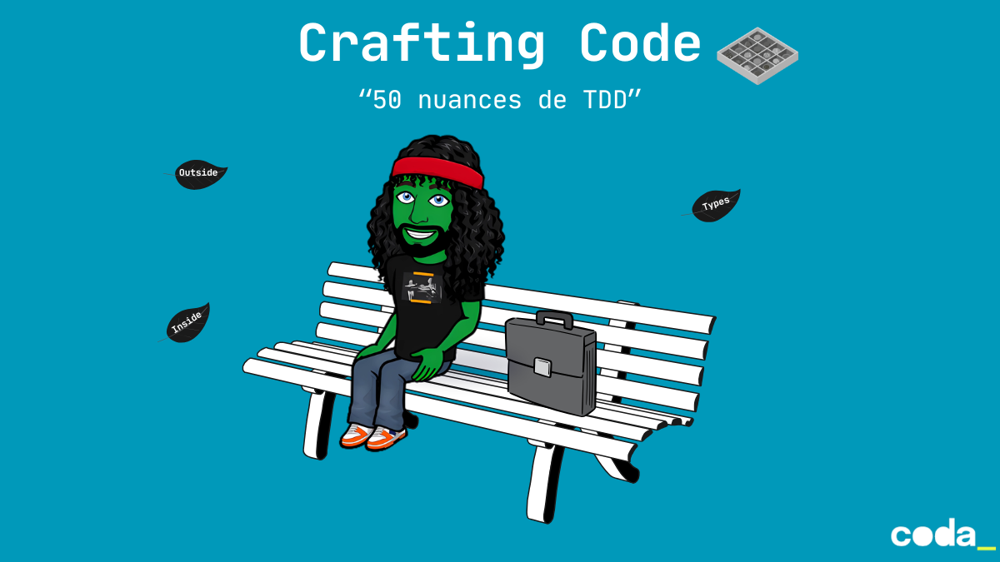

## Objectifs pédagogiques
- Expliquer les différences entre `T.D.D` et `B.D.D` 
- Mettre en œuvre le TDD selon les deux grandes écoles : `Chicago` (Classicist), `London` (outside-in)
- Utiliser l’`Example Mapping` pour faire émerger les règles métier, les exemples clés et les zones d’ambiguïté avant d’écrire du code 
- Clarifier les besoins métier pour sécuriser le delivery à travers des tests d’acceptation partagés 
- Écrire des scénarios lisibles et pertinents, orientés intention, sans sur-spécifier l’implémentation 
- Mettre en œuvre le `Type-Driven Development` pour laisser émerger la conception à partir des types et des exemples de test

## Lancer le site en local

```bash
# Installer mdbook
cargo install mdbook

# Lancer le serveur local
mdbook serve --open
```

Le site sera disponible sur [http://localhost:3000](http://localhost:3000).