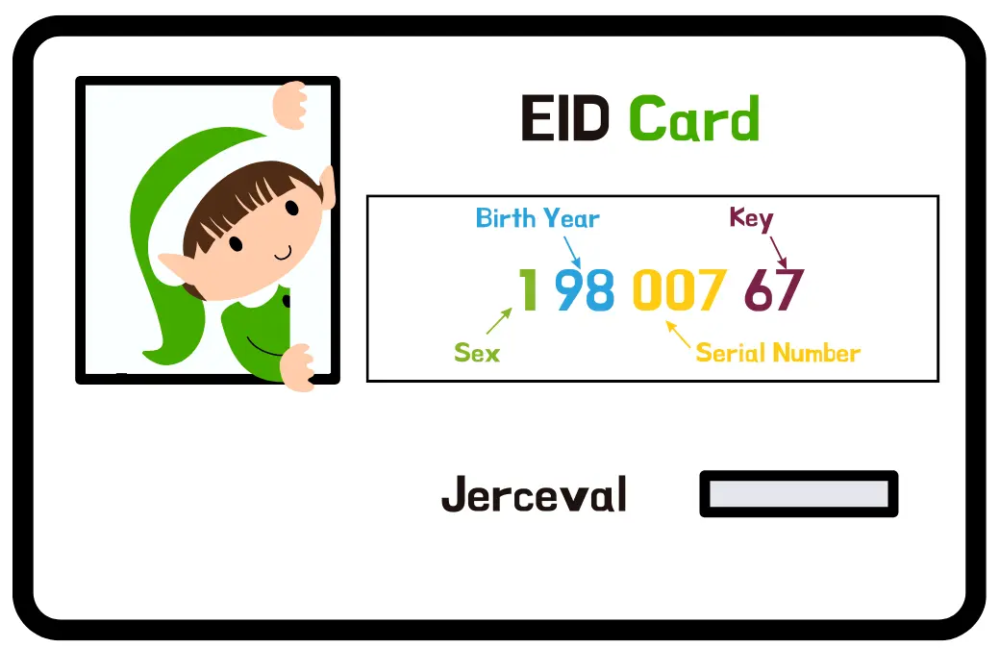

# Évaluation
**Durée : 3h**

## EID
Pour préparer sa tournée, le Père Noël a besoin de s'organiser avec ses elfes.
Il utilise un identifiant unique appelé `EID` pour reconnaître qui est qui.

> Concevoir un système capable de gérer les `EID`

### Règles de l'EID

`EID` signifie "Elf Identifier" (Identifiant Elfe) - c'est un identifiant unique représentant un elfe, composé de 8 caractères.
Les elfes sont créés magiquement chaque année, avec un maximum de 999 naissances.

Voici les exigences :

| Position(s) | Signification                                                                                    | Valeurs possibles |
|-------------|--------------------------------------------------------------------------------------------------|-------------------|
| 1           | Sexe : 1 pour `Sloubi`, 2 pour `Gagna`, 3 pour `Catact`                                          | 1, 2 ou 3         |
| 2, 3        | Deux derniers chiffres de l'année de naissance (précision au siècle près)                        | De 00 à 99        |
| 4, 5, 6     | "Numéro de série" : ordre de naissance dans l'année                                              | De 001 à 999      |
| 7, 8        | Clé de contrôle = complément à 97 du nombre formé par les 6 premiers chiffres de l'EID modulo 97 | De 01 à 97        |

Voici un exemple d'identifiant :


Utilisez `TDD` pour implémenter la logique de validation.

> **Consigne commits** : le cycle TDD doit être lisible dans l'historique git.
> Commitez régulièrement à chaque étape avec les préfixes suivants :
> - `red:` test écrit, il échoue
> - `green:` code minimal pour faire passer le test
> - `refactor:` amélioration du code sans changer le comportement
>
> Exemple : `red: EID invalide si clé de contrôle incorrecte`

---

## Barème

**Total : 20 points**

### 1. Pratique TDD - 8 points

| Critère                                  | Points | Description                                                                                                 |
|------------------------------------------|--------|-------------------------------------------------------------------------------------------------------------|
| Cycle Red / Green / Refactor respecté    | 3      | Chaque fonctionnalité est précédée d'un test qui échoue, puis rendue vert, puis refactorisé                 |
| Tests écrits avant le code de production | 2      | Aucun code de production n'existe sans test préalable                                                       |
| Petits pas (baby steps)                  | 2      | L'historique git montre une progression fine et régulière avec les préfixes `red:` / `green:` / `refactor:` |
| Utilisation du Canon TDD                 | 1      | Le Canon TDD est appliqué de façon visible (triangulation, transformation, ...)                             |

### 2. Qualité des tests - 5 points

| Critère                               | Points | Description                                                    |
|---------------------------------------|--------|----------------------------------------------------------------|
| Couverture des cas nominaux           | 2      | Les cas heureux de chaque règle EID sont testés                |
| Couverture des cas limites et erreurs | 2      | Valeurs invalides, cas limites                                 |
| Lisibilité et intention des tests     | 1      | Les noms de tests expriment clairement le comportement attendu |

### 3. Implémentation des règles EID - 4 points

| Critère                                                    | Points | Description                                    |
|------------------------------------------------------------|--------|------------------------------------------------|
| Validation du sexe (positions 1)                           | 0,5    | Valeurs 1, 2, 3 uniquement                     |
| Validation de l'année (positions 2-3)                      | 0,5    | De 00 à 99                                     |
| Validation du numéro de série (positions 4-6)              | 0,5    | De 001 à 999                                   |
| Calcul et validation de la clé de contrôle (positions 7-8) | 1,5    | Complément à 97, modulo 97, valeurs de 01 à 97 |
| Validation de la structure globale (longueur, format)      | 1      | Rejet de tout EID malformé                     |

### 4. Qualité du code de production - 3 points

| Critère                   | Points | Description                                                                      |
|---------------------------|--------|----------------------------------------------------------------------------------|
| Code propre et lisible    | 1      | Nommage clair, absence de code mort ou redondant                                 |
| Absence de sur-ingénierie | 1      | Pas de complexité inutile ; le code répond exactement aux tests                  |
| Refactoring visible       | 1      | Au moins une passe de refactoring documentée (commit, commentaire ou historique) |

> **Bonus (+1 point)** : Le fichier `RETRO.md` est rendu et démontre une réflexion sincère et pertinente. Les réponses sont concrètes, ancrées dans la session vécue, et ne se limitent pas à des généralités.

---

## Feedback - Mini-rétrospective de session

À l'issue de la session de pair programming, vous devez rédiger ensemble un fichier `RETRO.md` à déposer **à la racine de votre dépôt**.

Ce fichier doit répondre aux trois questions suivantes :
 - Qu'est-ce qui a bien fonctionné ? 
 - Qu'avons-nous appris ensemble ? 
 - Comment pourrait-on être plus efficace la prochaine fois ?

 - *Proposez au moins une action concrète d'amélioration pour votre prochaine session de pair programming.*

---

### Format attendu pour `RETRO.md`

```markdown
# Rétrospective - Kata EID

**Binôme :** Prénom1 NOM1 & Prénom2 NOM2
**Date :** JJ/MM/AAAA

## Ce qui a bien fonctionné
...

## Ce qu'on a appris ensemble
...

## Comment être plus efficace la prochaine fois
...
```
